<p align="center">
  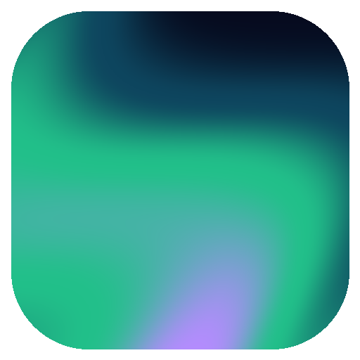
</p>

<h1 align="center">Drift</h1>

<p align="center">
  <b>Turn every monitor you own into one calm, living picture.</b><br>
  40 ambient scenes, your own videos and music, all flowing across your screens in step.
</p>

<p align="center">
  <a href="https://github.com/Rpyaanng/Drift/releases/latest"><b>⬇ Download for Windows</b></a>
  &nbsp;·&nbsp; Free &nbsp;·&nbsp; No account &nbsp;·&nbsp; No ads &nbsp;·&nbsp; MIT licensed
</p>

<p align="center">
  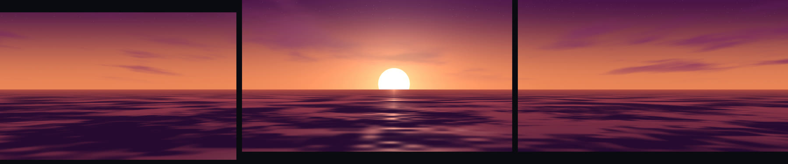
</p>

---

Your monitors sit dark most of the day. Drift gives them something beautiful to do: a sun setting
over the sea across all three screens, aurora rippling to your music, a hyperbolic tiling slowly
turning while you work, read or wind down. Start it, move the mouse once to pick a scene, and let it
drift.

## Why you'll like it

- **Made for more than one screen.** Drift draws **one scene across all your monitors**, lined up to
  where they really sit, even when they're different sizes. Or show the same scene on each, or give
  every monitor its own.
- **36 scenes and counting.** Northern lights, moonlit lakes, deserts, misty forests, 3D geometry,
  fractals and algorithms you can watch think.
- **It listens.** Scenes breathe with whatever is playing, whether that's the built-in soundscapes,
  your music folder or Spotify.
- **Your videos, on every screen.** Play a folder of films or clips across all your monitors, with
  subtitles that find themselves and sound that just works, even Dolby and DTS.
- **Watch together.** Share what you're watching with friends and it plays in step on their PCs too,
  straight from yours, encrypted, with no server in between.
- **Calm by design.** A clock, a breathing guide, a sleep timer that fades everything out, and a
  panel that disappears until you need it.

## Every monitor, your way

<p align="center">
  
</p>

One setting decides how Drift fills your screens:

| | |
| --- | --- |
| **Span** | One picture stretched across every monitor, like a window onto a wider world. |
| **Mirror** | The whole scene on each monitor. |
| **Mix** | A different scene or video on each monitor, as above. |

Need a screen back for work? **Close this monitor** from the exit prompt and Drift keeps running on the
others.

## The scenes

Every scene takes on the colours of the palette you choose (Aurora, Ocean, Sunset, Forest, Ember,
Lavender, Rosé, Moonlight and a near-black Dark for night), or one that slowly cycles through them all,
or colours you pick yourself.

**Ambient**: soft, endless motion to sit behind your day.

| | | | |
| :---: | :---: | :---: | :---: |
| 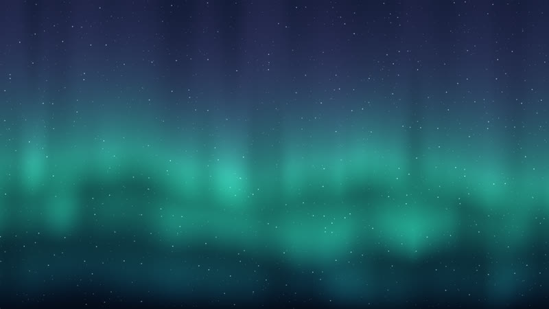<br>Aurora | <br>Deep Water | 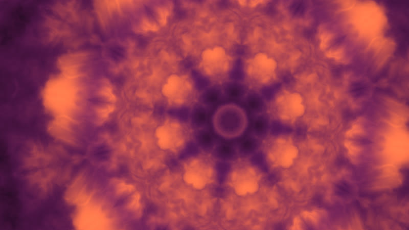<br>Mandala | 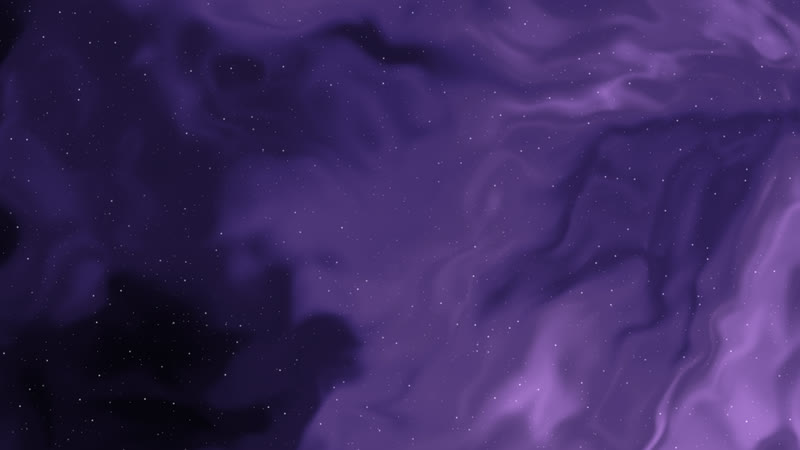<br>Nebula |

**Landscapes**: places to rest your eyes.

| | | | |
| :---: | :---: | :---: | :---: |
| <br>Mountain Lake | <br>Ocean Sunset | <br>Misty Forest | 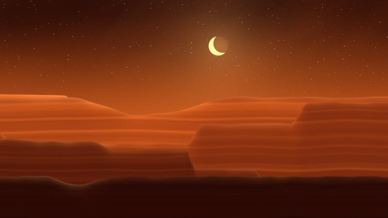<br>Canyon Night |

**Mathematics and algorithms**: hypnotic, with optional captions explaining what you're seeing.

| | | | |
| :---: | :---: | :---: | :---: |
| <br>Hyperbolic Tiling | 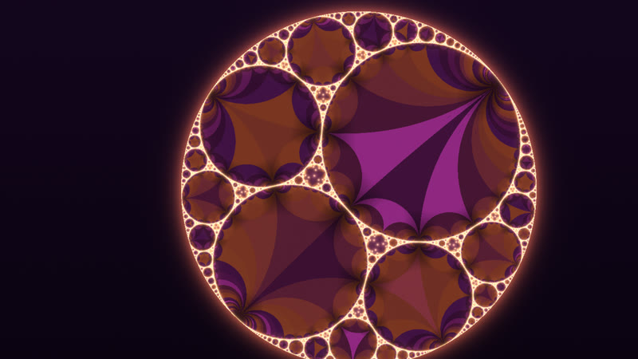<br>Apollonian Gasket | 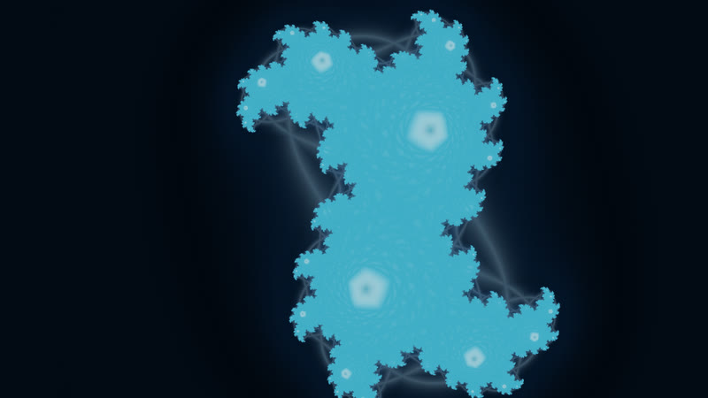<br>Julia Set | 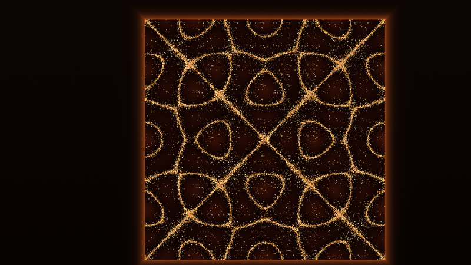<br>Chladni Plate |

**3D geometry**: slow-turning solids, tunnels and cities.

| | | | |
| :---: | :---: | :---: | :---: |
| <br>Wire Globe | 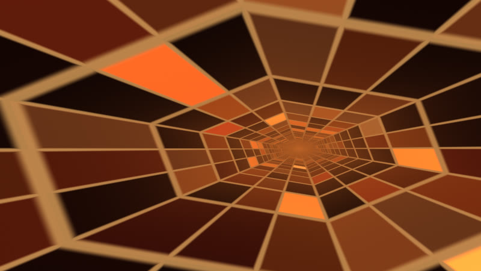<br>Hex Tunnel | 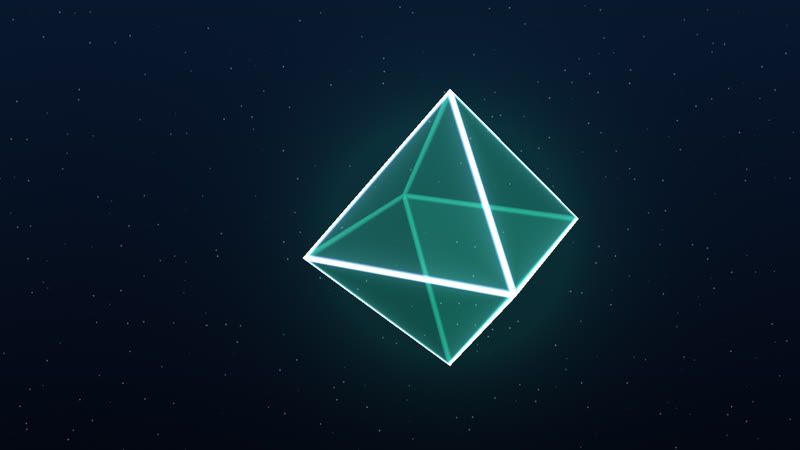<br>Platonic Solids | 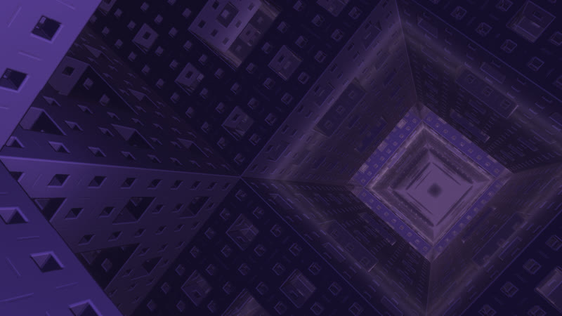<br>Menger Sponge |

<details>
<summary><b>See all 36 scenes</b></summary>

- **Ambient**: Aurora, Nebula, Silk, Deep Water, Starfield, Lava Lamp, Ridgelines, Ripples, Mandala,
  Bokeh, Horizon Lines
- **Landscapes**: Mountain Lake, Misty Forest, Desert Dunes, Ocean Sunset, Rolling Hills, Canyon Night
- **Algorithms**: Sierpiński Zoom, Sorting, Game of Life, Maze Solver, Julia Set, Hilbert Curve, Voronoi
- **3D geometry**: Platonic Solids, Wire Globe, Hex Tunnel, Cube City, Lattice, Menger Sponge
- **Mathematical geometry**: Quasicrystal (crossing waves that never repeat), Hyperbolic Tiling ({7,3},
  {5,4}, {8,3} and {4,5} tilings of the Poincaré disc), Apollonian Gasket, Phyllotaxis (golden-angle
  sunflower spirals), Rose Curves (r = cos kθ), Chladni Plate (sand on a vibrating plate)

Change scene automatically every few minutes, in order or shuffled. While it's on, each scene has a
tick in its corner: untick the ones you'd rather skip. Add a spectrum or waveform overlay if you like.

</details>

## Out of the way until you need it

<p align="center">
  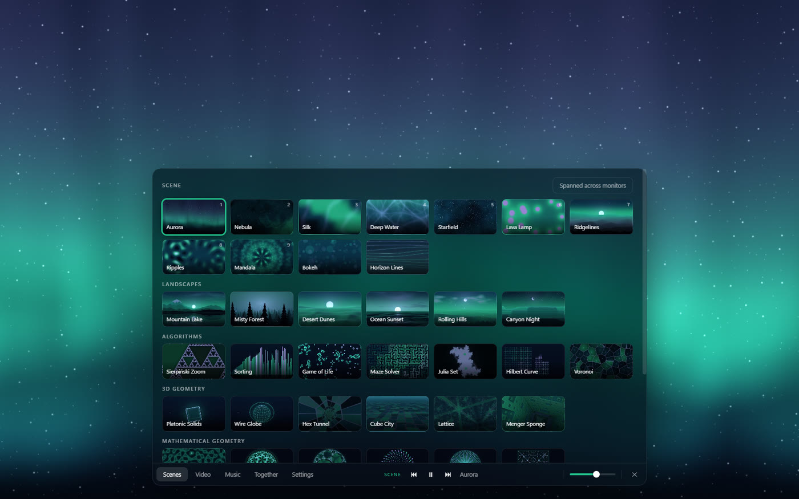
</p>

Move the mouse and a panel slides up on that screen; leave it and it's gone. Everything is a click or a
key away: scenes, colour, speed, brightness, music, video and volume.

## Sound and music

- **Built-in soundscapes**: Warm Pads, Deep Space, Crystal Bells and Morning Light, generated live rather
  than played from a loop.
- **Nature sounds**: rain, ocean waves, wind and a crackling fireplace, mixed to taste on top of
  anything.
- **Your music**: browse and search your own folders, shuffle, and watch the scenes dance to it.
- **Spotify**: control the Spotify app on your PC from Drift (play, pause, skip, volume, now playing)
  with no login. The visuals react to whatever it plays.

## Video, done properly

- **Play your folders** on every screen: spanned, mirrored or on just one monitor. Videos play one
  after another, or switch **Autoplay** off to stop at the end of each.
- **Subtitles that find themselves**: Drift picks your language from tracks inside the video or files
  beside it, or looks them up online by name. Size, colour, style and timing are yours to adjust, and
  remembered for each video.
- **It plays what you throw at it**: Dolby and DTS sound, HDR10, HLG and Dolby Vision, and older
  formats like MPEG-2, Xvid, WMV and AVI are converted live, using your NVIDIA, Intel or AMD graphics
  when it can. An HDR monitor next to an SDR one each get the right picture.
- **Monitors join in step**: switch another screen to the video that's playing and it picks up right
  where the others are.

## Watch together

Press **Share what I'm watching** and send the invite code. Up to eight friends paste it into their
Drift and see the same video, in step: play, pause and skipping stay together for everyone. The video
streams straight from your PC to theirs, encrypted, with no server, upload or account involved. A
friend who already has the file plays their own copy, and everyone picks their own subtitles.

## Get Drift

1. Download **Drift-Windows-x64.zip** from the [latest release](https://github.com/Rpyaanng/Drift/releases/latest)
   (Windows 10/11, 64-bit; ffmpeg included).
2. Unzip it anywhere and double-click `Drift.exe` inside the `Drift-win32-x64` folder.
3. Drift isn't code-signed yet, so Windows may say "Windows protected your PC". Click **More info** →
   **Run anyway**.

Your settings are saved and carry over to new versions.

---

## Controls

Move the mouse and the control panel appears at the bottom of the screen it's on. `Esc` asks before
quitting (`Enter` closes, `Esc` again stays), and from there you can also close just that monitor.

| Key | Action |
| --- | --- |
| `Tab` | Show/hide controls |
| `Space` | Play / pause |
| `Left` / `Right` | Previous / next |
| `Up` / `Down` | Volume |
| `1`–`9` | Pick a scene (Scenes tab) |
| `P` | Colour |
| `C` | Clock |
| `B` | Breathing guide |
| `S` | Subtitles on / off (during a video) |
| `V` | Next subtitle track |
| `Z` / `X` | Subtitles 0.1 s earlier / later |

### Watch together in detail

Play a video, open the **Together** tab and press **Share what I'm watching**. Send the invite code to a
friend; they paste it into the same tab and press **Join**. Up to eight friends can join.

- Play, pause, seeking and moving to the next video stay in step on every PC (untick *Friends can play,
  pause and skip* to keep the controls to yourself). With *Pause for everyone while someone is loading*,
  the video waits for a friend who is still loading, for up to 20 seconds.
- The video is streamed from the sharing PC as it plays, so nothing has to be sent beforehand, and jumping
  around works. A friend who already has the same file (same name and size) in their video folders plays
  their own copy instead.
- *Picture sent between PCs* makes the sharing PC send a smaller converted copy (1080p, 720p or 480p) when
  a connection can't keep up with the original. The sharing PC's upload speed is usually the limit.
- Subtitles on the sharing PC are offered to friends, and each person picks their own track, language and
  style. Sound and HDR conversion happen on each PC for its own screen; a friend without ffmpeg gets the
  sharing PC to convert for them.
- The invite code holds the sharing PC's addresses and a one-time secret. The connection is TLS keyed by
  that secret, so only people with the code can connect or see what is being watched. A new code is made
  every time sharing starts.

Reaching the sharing PC: on the same network it works as is. For friends elsewhere, Drift asks the
router (UPnP) to open one TCP port (47800 by default) while sharing and closes it afterwards; if the
router refuses, the Together tab says so, and forwarding that port by hand works too. In that case, and
when the router doesn't report its own address, Drift looks up this PC's public address at api.ipify.org.
Behind a provider that shares one address between homes (CGNAT), use a VPN such as Tailscale on both PCs.
Windows asks once whether to let Drift through its firewall: allow it.

### Video conversion

**Settings → Video conversion** needs ffmpeg (included in the release download).

- *HDR videos*: convert to SDR only on screens that aren't showing HDR (the default — an HDR monitor next
  to an SDR one each get the right picture), always, or never.
- *Convert with*: Automatic uses the fastest encoder that actually works on this PC, tried in the order
  NVIDIA, Intel, AMD, then the processor. Every encoder this copy of ffmpeg has and this PC can run is
  listed. H.264 plays everywhere; if an H.265 or AV1 stream won't play, Drift goes back to Automatic.
- *Converted picture size*: Match my screen avoids converting more pixels than the screen has, which is
  what makes 4K HDR practical on an ordinary PC.

A video the built-in player can't open is converted the same way without asking. Converting HDR needs an
ffmpeg built with zscale (libzimg) or libplacebo; the common full builds have both.

### Online subtitle lookup

In the Video tab, **Find online…** fills in the film or show name guessed from the file name. Pressing
Search sends that name to [Cinemeta](https://v3-cinemeta.strem.io) to identify the title, then asks the
public OpenSubtitles mirror used by Stremio for its subtitles. Neither needs an account. Nothing is sent
until Search is pressed, and only the text in the search box goes out. Results whose release name matches
the video file are listed first and marked "Likely match". Downloads are kept in Drift's settings folder,
not beside your videos.

### Privacy

Drift has no account, no telemetry and no ads. It only goes online when you ask it to: looking up
subtitles, or sharing a video with friends (and then finding your public address if your router doesn't
say). Spotify control talks to the Spotify app on this PC, not the internet.

## Development

Built with Electron and WebGL shaders.

```sh
npm install
npm start
```

### Building

```sh
npm run dev-build
```

This writes an unpacked (no asar) Windows x64 copy to `dev-build/Drift-win32-x64/`, with a
`BUILD-INFO.txt` recording the commit it was built from. To rebuild automatically after every commit,
turn on the included hook:

```sh
git config core.hooksPath .githooks
```

The app isn't code-signed, so Windows SmartScreen will warn on first launch
("More info" → "Run anyway").

### ffmpeg (video sound, HDR, other formats and subtitles inside videos)

Converting Dolby / DTS audio, HDR and other video formats, and reading subtitle tracks stored inside a
video all need `ffmpeg.exe`.
It isn't in this repo (too large for GitHub). Put a copy at `vendor/ffmpeg.exe` (ignored by git), or set
`FFMPEG_EXE` to its path, and `dev-build` copies it into the build's `resources` folder. A build made
without it warns, and the app says so in the Video tab instead of playing in silence.

At runtime Drift looks for ffmpeg in this order:

1. the path in the `DRIFT_FFMPEG` environment variable
2. `resources/ffmpeg.exe` next to the packaged app
3. `ffmpeg.exe` in the project folder, then `vendor/ffmpeg.exe`
4. any `ffmpeg.exe` on the `PATH`

### Developer switches

Environment variables for trying things out: `DRIFT_USERDATA=<folder>` runs a second copy with its own
settings (two copies on one PC can share with each other), `DRIFT_SHARE_LOCAL=1` keeps sharing on this PC,
`DRIFT_FAKE_HDR=0|1` pretends the screens are SDR or HDR, `DRIFT_HIDDEN=1` and `DRIFT_MUTE=1` run without
windows or sound. `DRIFT_SHOTS=<folder>` runs the screenshot tour (add `DRIFT_ONLY=<scene,...>`,
`DRIFT_PALETTE=<name>`, `DRIFT_PANEL=1` and `DRIFT_SHOTWAIT=<ms>` to wait longer per scene); the README images
were made with it.

## License

MIT
