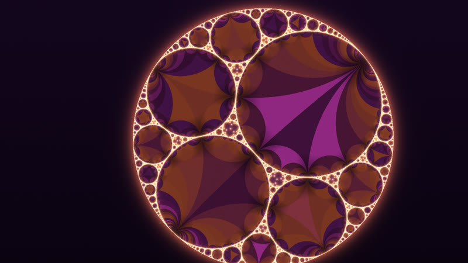
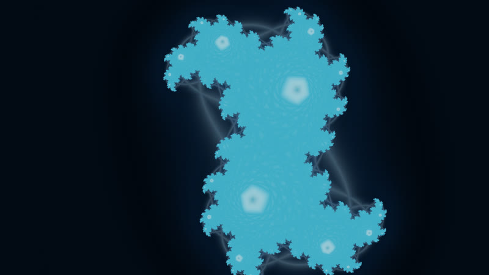
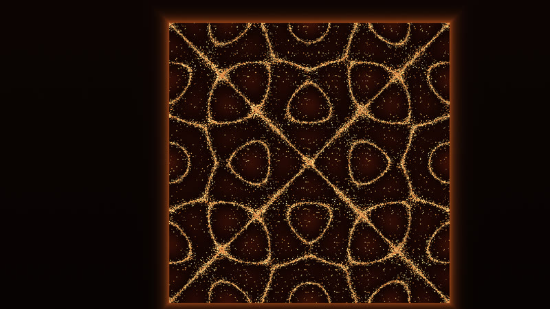
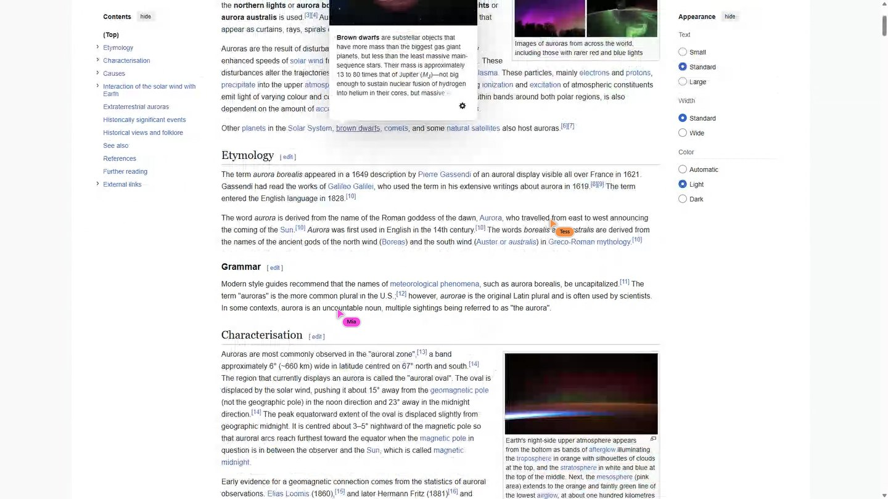

<p align="center">
  
</p>

<h1 align="center">Drift</h1>

<p align="center">
  <b>Turn every monitor you own into one calm, living picture.</b><br>
  40 ambient scenes, your own videos and music, all flowing across your screens in step.
</p>

<p align="center">
  <a href="https://github.com/Rpyaanng/Drift/releases/latest"><b>⬇ Download for Windows</b></a>
  &nbsp;·&nbsp; Free &nbsp;·&nbsp; No account &nbsp;·&nbsp; No ads &nbsp;·&nbsp; MIT licensed
</p>

<p align="center">
  
</p>

---

Your monitors sit dark most of the day. Drift gives them something beautiful to do: a sun setting
over the sea across all three screens, aurora rippling to your music, a hyperbolic tiling slowly
turning while you work, read or wind down. Start it, move the mouse once to pick a scene, and let it
drift.

## Why you'll like it

- **Made for more than one screen.** Drift draws **one scene across all your monitors**, lined up to
  where they really sit, even when they're different sizes. Or show the same scene on each, or give
  every monitor its own.
- **36 scenes and counting.** Northern lights, moonlit lakes, deserts, misty forests, 3D geometry,
  fractals and algorithms you can watch think.
- **It listens.** Scenes breathe with whatever is playing, whether that's the built-in soundscapes,
  your own music or Spotify.
- **Your videos, on every screen.** Play a folder of films or clips across all your monitors, with
  subtitles that find themselves and sound that just works, even Dolby and DTS.
- **Hub.** A place for your friends to chat, with channels and history, hosted in your own Drift.
  Share what you're watching there and it plays in step on their PCs too, straight from yours, encrypted.
- **Calm by design.** A clock, a breathing guide, a sleep timer that fades everything out, and a
  panel that disappears until you need it.

## Every monitor, your way

<p align="center">
  
</p>

One setting decides how Drift fills your screens:

| | |
| --- | --- |
| **Span** | One picture stretched across every monitor, like a window onto a wider world. |
| **Mirror** | The whole scene on each monitor. |
| **Mix** | A different scene or video on each monitor, as above. |

Need a screen back for work? **Close this monitor** from the exit prompt and Drift keeps running on the
others.

## The scenes

Every scene takes on the colours of the palette you choose (Aurora, Ocean, Sunset, Forest, Ember,
Lavender, Rosé, Moonlight and a near-black Dark for night), or one that slowly cycles through them all,
or colours you pick yourself.

**Ambient**: soft, endless motion to sit behind your day.

| | | | |
| :---: | :---: | :---: | :---: |
| <br>Aurora | <br>Deep Water | <br>Mandala | <br>Nebula |

**Landscapes**: places to rest your eyes.

| | | | |
| :---: | :---: | :---: | :---: |
| <br>Mountain Lake | <br>Ocean Sunset | <br>Misty Forest | <br>Canyon Night |

**Mathematics and algorithms**: hypnotic, with optional captions explaining what you're seeing.

| | | | |
| :---: | :---: | :---: | :---: |
| <br>Hyperbolic Tiling | <br>Apollonian Gasket | <br>Julia Set | <br>Chladni Plate |

**3D geometry**: slow-turning solids, tunnels and cities.

| | | | |
| :---: | :---: | :---: | :---: |
| <br>Wire Globe | <br>Hex Tunnel | <br>Platonic Solids | <br>Menger Sponge |

<details>
<summary><b>See all 36 scenes</b></summary>

- **Ambient**: Aurora, Nebula, Silk, Deep Water, Starfield, Lava Lamp, Ridgelines, Ripples, Mandala,
  Bokeh, Horizon Lines
- **Landscapes**: Mountain Lake, Misty Forest, Desert Dunes, Ocean Sunset, Rolling Hills, Canyon Night
- **Algorithms**: Sierpiński Zoom, Sorting, Game of Life, Maze Solver, Julia Set, Hilbert Curve, Voronoi
- **3D geometry**: Platonic Solids, Wire Globe, Hex Tunnel, Cube City, Lattice, Menger Sponge
- **Mathematical geometry**: Quasicrystal (crossing waves that never repeat), Hyperbolic Tiling ({7,3},
  {5,4}, {8,3} and {4,5} tilings of the Poincaré disc), Apollonian Gasket, Phyllotaxis (golden-angle
  sunflower spirals), Rose Curves (r = cos kθ), Chladni Plate (sand on a vibrating plate)

Change scene automatically every few minutes, in order or shuffled. While it's on, each scene has a
tick in its corner: untick the ones you'd rather skip. Add a spectrum, waveform or halo overlay if you like.

</details>

## Out of the way until you need it

<p align="center">
  
</p>

Move the mouse and a panel slides up on that screen; leave it and it's gone. Everything is a click or a
key away: scenes, colour, speed, brightness, music, video and volume.

## Sound and music

- **Ambient sound**, in the **Scenes** tab: Warm Pads, Deep Space, Crystal Bells and Morning Light,
  generated live rather than played from a loop, or **Off**.
- **Nature sounds**: rain, ocean waves, wind and a crackling fireplace, mixed to taste on top of
  anything (also in Scenes).
- **Your music**: the **Media** tab shows your music next to your videos, in the same folders. Pick a song
  and the scenes dance to it; the ambient sound waits and comes back when you press **Stop music**.
- **Spotify**: there is nothing to set up. While a song plays in the Spotify app on your PC and Drift
  has no video or music of its own on, the toolbar's play, pause, skip and volume control Spotify, with
  the song's name beside them, and the visuals react to it. No login.
- **Volume mixer**: click the speaker in the toolbar for a slider per sound, as in Windows' own mixer:
  Drift as a whole (it turns down everything below and friends' voices together); **Ambient**, the
  generated music with the rain, waves, wind and fire; **Media**, your videos and music from the Media
  tab; Surf's web pages; and Spotify when it's playing. Click a row's icon
  to mute it. The slider beside the speaker is for whatever you're on; on the Surf tab it turns down every
  web page at once (a page's own volume control still works inside that). Sound a page makes only through
  Web Audio, as some games do, isn't reached.

## Video, done properly

- **Play your folders** on every screen: spanned, mirrored or on just one monitor. Videos play one
  after another, or switch **Autoplay** off to stop at the end of each.
- **Subtitles that find themselves**: Drift picks your language from tracks inside the video or files
  beside it, or looks them up online by name. Size, colour, style and timing are yours to adjust, and
  remembered for each video.
- **It plays what you throw at it**: Dolby and DTS sound, HDR10, HLG and Dolby Vision, and older
  formats like MPEG-2, Xvid, WMV and AVI are converted live, using your NVIDIA, Intel or AMD graphics
  when it can. An HDR monitor next to an SDR one each get the right picture.
- **Monitors join in step**: switch another screen to the video that's playing and it picks up right
  where the others are.
- **Back where you left it**: Drift opens with the video or song you had on, paused at the same spot and
  ready to carry on when you press play.
- **Smooth next to busy scenes**: if heavy scenes on your other monitors start holding a video back,
  those scenes ease off their frame rate (never their sharpness) until the video plays smoothly again.

## Watch together

The **Hub** tab is where your friends are: a *hub* with channels to chat in and a voice room to talk in,
hosted by your Drift. Each hub has two streams everyone in it watches together: the **media stream** (a video
or music) and the **Surf stream** (one web browser for the whole hub). While you're online in one,
picking a video or music in **Media** streams it there, and everyone online in the
hub watches it without pressing anything. Up to eight of them see the same thing, in step: play, pause and skipping stay together
for everyone. It streams straight from your PC to theirs, encrypted, with no server, upload or account
involved. A friend who already has the file plays their own copy, and everyone picks their own subtitles.
If nothing's on, yours starts straight away. If someone else's is on, a card pops up over everyone's
video asking whether to switch. If more than half of the people online agree within 30 seconds, theirs
stops and yours goes on. Drift doesn't connect to your hubs when it starts: you're online in one, and on
its streams, once you click it. If you'd rather not watch, disconnect from the hub.
Open a hub and you're in its voice room, listening; press **Talk** to be heard. It's end-to-end
encrypted, and Drift shows a lock on each connection it has verified.

## Surf, alone or with your hub

<p align="center">
  
</p>

The **Surf** tab puts a web browser on any screen, opening on Drift's own start page: a clock, a search
box and a few places to drift to. While you're online in a hub, the Surf tab is the hub's **Surf stream**
instead: one browser everyone in the hub shares, running on the host's PC. Anyone can open a page, click,
scroll, type and change tabs, and everyone sees and hears the same thing at the same moment. Everyone's mouse
shows over the page as a coloured arrow with their name, so you can point things out to each other. Your own
browser is put away meanwhile and comes back, with its tabs, when you disconnect. Close Drift
with the browser open and your tabs come back next time, without anything starting to play by itself.
With more than one monitor, the two-screens button in the browser's bar shows the page on all your other
monitors too, and you can click, scroll and type in it from any of them. Choosing **Mirror** in Settings while a page is
open does the same, and Span or Mix puts it back on its own monitor. While mirrored, the page keeps the layout of the
monitor you browse on, stretched a little toward the shape of your other monitors (an ultrawide or a portrait screen) so
the black bars are shared out: the monitor you browse on never shows it more than 15% smaller, and every monitor shows it whole.
Mirrored pages are sent to your other monitors as a video stream. For a sharper, smoother picture at your screen's
full frame rate, try **Settings → Draw Surf on the graphics card** (experimental): pages are then drawn off screen and
handed to every monitor straight from the graphics card, with no video encoding in between.

<p align="center">
  
</p>

## Get Drift

1. Download **Drift-Windows-x64.zip** from the [latest release](https://github.com/Rpyaanng/Drift/releases/latest)
   (Windows 10/11, 64-bit; ffmpeg included).
2. Unzip it anywhere and double-click `Drift.exe` inside the `Drift-win32-x64` folder.
3. Drift isn't code-signed yet, so Windows may say "Windows protected your PC". Click **More info** →
   **Run anyway**.

Your settings are saved and carry over to new versions.

From 1.5.0 on, Drift **updates itself**. Now and then it checks for a new release. When there is one, a
download icon appears on the **Settings** tab; press **Download update** under *Updates*, then restart
straight away or let it install when you close Drift. Tick *Update Drift automatically* there (it's off to
start with) to have new releases downloaded in the background and installed when you close Drift. Copies of 1.4.1 and older need this one update by hand.

---

## Controls

Move the mouse and the control panel appears at the bottom of the screen it's on. `Esc` asks before
quitting (`Enter` closes, `Esc` again stays), and from there you can also close just that monitor.

| Key | Action |
| --- | --- |
| `Tab` | Show/hide controls |
| `Space` | Play / pause |
| `Left` / `Right` | Previous / next |
| `Up` / `Down` | Volume |
| `1`–`9` | Pick a scene (Scenes tab) |
| `P` | Colour |
| `C` | Clock |
| `B` | Breathing guide |
| `S` | Subtitles on / off (during a video) |
| `V` | Next subtitle track |
| `Z` / `X` | Subtitles 0.1 s earlier / later |

### Watch together in detail

Open the **Hub** tab and host a hub, then press **Copy an invite** and send the code to friends; they
paste it into the same tab and press **Join**. From then on they're in the hub. Click it to be online there,
then play a video or music and it's on everyone's screen; open Surf and you're on the hub's Surf stream. What's playing also shows as a card
in the chat. Up to eight friends can watch at once.

- Chat: channels anyone in the hub can make, replies, editing (↑ edits your last message), deleting, and
  a little formatting (`**bold**`, `*italic*`, `` `code` ``, `||spoiler||`, `> quote`). Links open in Surf
  after showing where they go. An emoji picker, emoji reactions on any message, and pictures and GIFs
  (paste, drop or press +, up to 4 MB; photos are re-saved so where they were taken isn't sent). Messages are kept on the PC of whoever hosts the hub, and the hub only
  works while that Drift is open. Everyone is equal except the host, who can remove someone for good,
  delete any message and stop all invites working. **Block** hides someone's messages from you only.
- While you watch together, messages from the hub float over the video in a corner of the screen and
  fade after a few seconds, so nobody has to open the panel. While you're online in a hub, **Enter** opens a
  small box to write in from anywhere in Drift (the Hub tab's own box when that's open), to what you're
  watching's hub or else your active one. Over Surf, Enter stays the page's: use the 💬 in the bottom-left corner. In
  *Options* you choose whose messages show: people who can't be heard (not in the call, muted, or with no
  working microphone), every message, or none. People whose PC has no microphone are marked *no mic*.
- *Options* also sets your picture. Drift cuts it to a square and saves it again small, which drops what
  else the file carried (such as where a photo was taken), and every hub you're in shows it.
- A hub invite works for 7 days. It holds the hub's addresses and the fingerprint of its certificate,
  so nobody else can pretend to be the hub. Each person is a key made by their Drift, kept encrypted
  by Windows; there are no accounts or passwords. The hub uses port 47900, TCP for the chat and UDP for
  voice.

**Voice.** Each hub has one voice room, for up to 16 people with 8 talking at once. Being online in a hub
puts you in its room, listening: there's nothing to start or join. You're in one hub's room at a time, the
one open in the Hub tab (or the one you **Keep voice here**). Your microphone stays closed until you press
**Talk**, and closes again when you press **Mute**; it starts closed every time Drift starts, unless you
turn on *Keep my microphone on between sessions*. While you're in a room, a small bar over the scenes shows
the hub, rings whoever is speaking, and has **Talk** / **Mute**, **Don't listen** and **Disconnect** (go
offline from that hub without leaving it; click the hub to come back). It stays bright while your
microphone is open. The tray shows a light, grey while your microphone is closed and red while it's open;
clicking it turns Talk on or off. Each person has their own volume slider, for you only. *Hold a key to
talk* (in *Options*) works even while another program has the keyboard: the key under Esc, Right Ctrl, or
a mouse's side buttons.

- **End-to-end encrypted, even from the hub.** The sound goes from your PC to each friend's, encrypted
  (DTLS-SRTP). The hub only passes on the messages that set each connection up, and your Drift signs each
  of those with your key; theirs checks the signature, and then checks that the connection really uses the
  certificate you signed. So a hub can't listen in without it showing. Each connection that passes gets a
  🔒, and *End-to-end encrypted* only appears when every connection you have in the room has one. If a check fails, Drift doesn't connect to that person and says so: *Couldn't verify Ana. The hub
  may be interfering.*
- **Your address stays private.** Voice goes through the hub's PC by default, so nobody in the room learns
  anyone else's IP address (the hub passes the sound on, but can't hear it). *Connect directly*
  lowers the delay a little, for friends who don't mind seeing each other's addresses.
- **Safety numbers.** Click someone's name under *People* to see a 12-digit safety number for the two of
  you. Compare it in person or on the phone; if yours match, nobody (not even the hub) is pretending to be
  either of you, and you can mark them verified. Drift remembers who it has met in each hub, and warns if
  a name you know turns up with a different key.
- For echo cancelling to remove the sound of what you're watching, play both the video and voice on
  Windows' default sound output.

- Play, pause, seeking and moving to the next video stay in step on every PC (untick *Friends can play,
  pause and skip* to keep the controls to yourself). With *Pause for everyone while someone is loading*,
  the video waits for a friend who is still loading, for up to 20 seconds.
- The video is streamed from the sharing PC as it plays, so nothing has to be sent beforehand, and jumping
  around works. A friend who already has the same file (same name and size) in their video folders plays
  their own copy instead.
- *Picture sent between PCs* makes the sharing PC send a smaller converted copy (1080p, 720p or 480p) when
  a connection can't keep up with the original. The sharing PC's upload speed is usually the limit.
- Subtitles on the sharing PC are offered to friends, and each person picks their own track, language and
  style. Sound and HDR conversion happen on each PC for its own screen; a friend without ffmpeg gets the
  sharing PC to convert for them.
- Each share has its own code, passed to the hub's members inside the Join card. It holds the sharing
  PC's addresses and a one-time secret. The connection is TLS keyed by that secret, so only people with
  the code can connect or see what is being watched. A new code is made every time sharing starts. An
  older watch-together code pasted into the Join box still works.

Reaching the sharing PC: on the same network it works as is. For friends elsewhere, Drift asks the
router (UPnP) to open one TCP port (47800 by default) while sharing and closes it afterwards; if the
router refuses, the Hub tab says so, and forwarding that port by hand works too. In that case, and
when the router doesn't report its own address, Drift looks up this PC's public address at api.ipify.org.
Behind a provider that shares one address between homes (CGNAT), use a VPN such as Tailscale on both PCs.
Windows asks once whether to let Drift through its firewall: allow it.

### Listening to music together

While you are sharing, friends hear your music too: the **ambient sound** and music from your library are
sent to them as one live stream, straight from your PC, so everyone hears the same moment of it (a fraction
of a second after you do). There is nothing to set up: put music on and it reaches whoever has joined.

- A friend's own music waits while they are in your session, and each friend sets their own volume. Their
  visuals move to your music.
- With *Friends can play, pause and skip, and use a web page* ticked, their play, pause, next and previous
  work on your music.
- **Spotify** is not sent: it is Spotify's sound, not Drift's. Nature sounds stay on your own PC too.
- When a video with its sound on takes over from the music on your PC, it does for friends as well.

### Who is where

During a session each tab in the panel carries a small number: how many people (you included) are on it
right now, so you can see who has wandered off to Settings or is looking at the same page as you.

### Surf: a browser in Drift, alone or with your hub

The **Surf** tab is a small web browser. Choose it and the browser opens on that screen, in place of the
scene, on Drift's own start page: a clock, a search box (an address, or something to search Google for)
and a few places to drift to. While you're online in a hub it's that hub's Surf stream (below).

- **The bar at the top.** Move the mouse to the very top edge of the screen and a floating bar drops down
  with your tabs, **+** for a new tab, back, forward, reload, home and the address. It slips away again
  when the mouse leaves it. A link that asks for a new tab opens one. A small window a page opens when you
  click (sign in with Google, PayPal…) opens over Drift, on your PC only; pop-ups that open by themselves are
  blocked. Up to 12 tabs.
- **Keyboard shortcuts**, as in other browsers: `Ctrl+T` new tab, `Ctrl+W` close tab, `Ctrl+Shift+T` reopen
  the last tab closed, `Ctrl+Tab` / `Ctrl+Shift+Tab` (or `Ctrl+PgDn` / `Ctrl+PgUp`) next and previous tab,
  `Ctrl+1`…`Ctrl+8` a tab, `Ctrl+9` the last tab, `Ctrl+L` / `Alt+D` / `F6` the address, `Ctrl+R` / `F5`
  reload (`Ctrl+Shift+R` / `Ctrl+F5` past the cache), `Alt+Left` / `Alt+Right` back and forward, `Alt+Home`
  the start page, and `Ctrl` with `+`, `-`, `0` or the mouse wheel to zoom. They work on a hub's Surf
  stream too.
- **Drift's own panel.** The page takes the mouse and keyboard while it is showing. Move the mouse to the
  very bottom edge of the screen for the panel, or press `Esc` in the page (when a video is full screen,
  the first `Esc` leaves that). With Surf selected, the panel's previous / next buttons go back and
  forward, and the video progress bar is hidden.
- **Leaving Surf.** Choosing Scenes or Media on the browser's screen puts the browser away so you can
  see them. Your tabs stay open behind them, exactly as you left them, so coming back to Surf shows
  them again straight away without loading them again. A video playing in one keeps playing, as in a
  background tab. Hub and
  Settings leave the browser where it is. Closing the last tab closes the browser.
- **Next time.** If the browser is open when Drift closes, its tabs, the tab in front and its monitor come
  back when Drift starts again. Video and music in those pages stay paused until you click or press a key
  in the page.
- The browser is on one monitor; the others carry on with their scenes. Choosing Surf on another monitor
  moves it there (the pages load again).
- Sign-ins made in Drift are kept apart from your normal browser.
- Copy-protected video (Widevine) plays, and the hub sees it too on the Surf stream. The first time Surf opens, Chromium downloads
  Widevine from Google (a few MB) and keeps it up to date. Netflix also needs a release that castLabs has
  signed (see Building). Like other Chromium-based browsers apart from Chrome and Edge, Surf gets these
  services' lower quality, usually 720p.
- *Block adverts in Surf* (in Settings, on by default) blocks adverts and trackers in pages with
  uBlock Origin itself, running inside Surf as it does in Chrome: the same filter lists, element hiding,
  and the scripts it runs in pages to take adverts out from the inside (YouTube's video adverts, for one).
  The first time, Drift downloads one exact release of it from uBlock Origin's GitHub page (about 6 MB,
  checked against a known fingerprint) into its own settings folder. uBlock Origin then keeps its filter
  lists up to date by itself. Sites fight blockers, so now and then an advert gets through, or a page
  misbehaves: untick it and the pages reload without blocking. uBlock Origin is
  [gorhill/uBlock](https://github.com/gorhill/uBlock), GPLv3. Drift doesn't include it; it fetches it.

### The Surf stream: one browser for the whole hub

Online in a hub, the Surf tab is the hub's Surf stream: a browser running on the host's PC that everyone in
the hub shares. It runs side by side with the media stream, so one person's video can be on while another
scrolls a page. Nobody owns it and there's no vote: anyone online can open a page, click, scroll, type and
open or close tabs, and two people typing at once interleave, as at one keyboard.

- **On the host's PC** it's a second browser in a profile of its own, signed out of everything, with none of
  the host's cookies, history or sign-ins. The host's Surf tab shows it straight from the graphics card while
  they're online in their hub; disconnecting brings their own browser back while the hub's carries on for
  everyone else. Its tabs are kept while the hub runs and across restarts, until the host presses
  **Settings → Your hub's Surf stream → Clear**. It starts the first time anyone opens Surf while online.
- **Everyone else** gets a picture of it with its sound, streamed from the host's PC: 1080p at 30 frames a
  second, H.264 when the graphics card can encode it, up to about 8 Mbit/s of the host's upload for each
  person watching, and up to seven watching at once. It's relayed through the hub (so nobody sees anyone's
  address) unless *Connect directly* is on, end-to-end encrypted, and every setup message is signed, as in
  voice. Watching starts when you open the Surf tab, and its sound keeps playing at the mixer's Surf level
  while you're on another tab, so it can be the hub's radio.
- **The bar along the top** shows its tabs and address, and a line says whose Surf stream it is, with the
  faces of whoever is watching. The hub bar shows its front tab next to what's on the media stream.
- **What can't happen**, because it would happen on the host's PC: pop-up windows (a link asking for a new
  window opens a tab instead), file pickers, page dialogs, permissions (camera, microphone, location),
  reaching the host's own network (their router, other PCs, Drift's own ports: the check is on the address a
  name really resolves to, and the host can allow particular local addresses in Settings), and downloads the
  host hasn't agreed to.
- **Downloads** wait for the host. A card on the host's screens says who wants what, from where, with
  **Save** and **Refuse**. Save puts it in the host's Downloads folder; Refuse, or no answer in a minute,
  deletes it. The file never leaves the host's PC. The host can refuse them all in Settings.
- **Signed in for everyone.** Anything signed into on the Surf stream is signed in for everyone in the hub,
  and Drift says so the first time someone types into a password box there. Password boxes still can't be
  turned into plain text. Pages load from the host's internet connection, so sites see the host's address;
  the host is told the first time it starts.
- **Blocking** someone hides their pointer from you. Their input still reaches the page, since it's one
  shared browser. The host can remove someone from the hub.
- `Alt+←` / `Alt+→` (or the mouse's side buttons) go back and forward.

### Video conversion

**Settings → Video conversion** needs ffmpeg (included in the release download).

- *HDR videos*: convert to SDR only on screens that aren't showing HDR (the default — an HDR monitor next
  to an SDR one each get the right picture), always, or never.
- *Convert with*: Automatic uses the fastest encoder that actually works on this PC, tried in the order
  NVIDIA, Intel, AMD, then the processor. Every encoder this copy of ffmpeg has and this PC can run is
  listed. H.264 plays everywhere; if an H.265 or AV1 stream won't play, Drift goes back to Automatic.
- *Converted picture size*: Match my screen avoids converting more pixels than the screen has, which is
  what makes 4K HDR practical on an ordinary PC.

A video the built-in player can't open is converted the same way without asking. Converting HDR needs an
ffmpeg built with zscale (libzimg) or libplacebo; the common full builds have both.

### Online subtitle lookup

In the Media tab, **Find online…** fills in the film or show name guessed from the file name. Pressing
Search sends that name to [Cinemeta](https://v3-cinemeta.strem.io) to identify the title, then asks the
public OpenSubtitles mirror used by Stremio for its subtitles. Neither needs an account. Nothing is sent
until Search is pressed, and only the text in the search box goes out. Results whose release name matches
the video file are listed first and marked "Likely match". Downloads are kept in Drift's settings folder,
not beside your videos.

### Privacy

Drift has no account, no telemetry and no ads. Apart from checking for updates (see below), it only goes online when you ask it to: looking up
subtitles, chatting, calling or sharing a video with friends (and then finding your public address if your
router doesn't say). Calls go through your hub's PC, not a company's server, and are end-to-end encrypted. Spotify control talks to the Spotify app on this PC, not the internet. Nothing about you goes with
the update check: it is a plain request for the release list. Drift asks GitHub about its latest release a
little after it starts and every 12 hours after that. It downloads a new release from GitHub when you press
*Download update*, or by itself with *Update Drift automatically* on (in Settings).

## Development

Built with [castLabs' Electron](https://github.com/castlabs/electron-releases) (Electron with Widevine) and WebGL shaders.

```sh
npm install
npm start
```

### Building

```sh
npm run dev-build
```

This writes an unpacked (no asar) Windows x64 copy to `dev-build/Drift-win32-x64/`, with a
`BUILD-INFO.txt` recording the commit it was built from. To rebuild automatically after every commit,
turn on the included hook:

```sh
git config core.hooksPath .githooks
```

The app isn't code-signed, so Windows SmartScreen will warn on first launch
("More info" → "Run anyway").

**Netflix needs a VMP signature.** Widevine plays without one, but Netflix (and a few others) only send
video to builds castLabs has signed. Their EVS signing service is free. Set it up once:

```sh
pip install --upgrade castlabs-evs
python -m castlabs_evs.account signup
```

From then on, `dev-build` signs every build, after any other signing as VMP requires. Without EVS it warns
and builds anyway.

### ffmpeg (video sound, HDR, other formats and subtitles inside videos)

Converting Dolby / DTS audio, HDR and other video formats, and reading subtitle tracks stored inside a
video all need `ffmpeg.exe`.
It isn't in this repo (too large for GitHub). Put a copy at `vendor/ffmpeg.exe` (ignored by git), or set
`FFMPEG_EXE` to its path, and `dev-build` copies it into the build's `resources` folder. A build made
without it warns, and the app says so in the Media tab instead of playing in silence.

At runtime Drift looks for ffmpeg in this order:

1. the path in the `DRIFT_FFMPEG` environment variable
2. `resources/ffmpeg.exe` next to the packaged app
3. `ffmpeg.exe` in the project folder, then `vendor/ffmpeg.exe`
4. any `ffmpeg.exe` on the `PATH`

### Developer switches

Environment variables for trying things out: `DRIFT_USERDATA=<folder>` runs a second copy with its own
settings (two copies on one PC can share with each other), `DRIFT_SHARE_LOCAL=1` keeps sharing on this PC,
`DRIFT_FAKE_HDR=0|1` pretends the screens are SDR or HDR, `DRIFT_HIDDEN=1` and `DRIFT_MUTE=1` run without
windows or sound. `DRIFT_SHOTS=<folder>` runs the screenshot tour (add `DRIFT_ONLY=<scene,...>`,
`DRIFT_PALETTE=<name>`, `DRIFT_PANEL=1` and `DRIFT_SHOTWAIT=<ms>` to wait longer per scene); the README images
were made with it. Add `DRIFT_TESTSURF=1` for the picture of Surf's start page. `DRIFT_TESTMIRROR=1` with `DRIFT_FAKE_DISPLAYS=2` checks Surf's mirroring (`DRIFT_FAKE_WIDTHS=1,2` makes the fake monitors different widths; add `DRIFT_TESTGPU=1` for the graphics-card drawing, and `DRIFT_HIDDEN=1` so your own mouse can't reach the test page). `DRIFT_TESTKEYS=1` presses Surf's keyboard shortcuts in a test page (add `DRIFT_TESTGPU=1` for the offscreen page). `DRIFT_TESTMIX=1` checks the volume mixer's Surf and master levels inside a test page and its frame, and takes a picture of the mixer. `DRIFT_TESTPARK=1` checks that a Surf page put away (Scenes) and shown again is the same page, not loaded again (`DRIFT_TESTGPU=1` works here too). 
`node scripts/test-surf-stream.js` runs two copies through a hub's Surf stream (`DRIFT_TESTSS=host|guest`), and
`node scripts/test-surf-lan.js` checks its guard against the host's own network (no Electron needed).
Chat and calls have their own checks: `node scripts/test-chat.js` and `node scripts/test-voice.js` (no
Electron needed; both also run under `ELECTRON_RUN_AS_NODE=1`), and `node scripts/test-calls.js`, which
runs three copies of Drift in a call (`DRIFT_TESTVOICE=host|guest|third`) honestly and with the hub
misbehaving on purpose (`DRIFT_HUB_TAMPER=fingerprint|unsigned|replay|swapkey`, aimed with
`DRIFT_HUB_TAMPER_PAIR=From>To`). `node scripts/test-broadcast-ui.js` runs two copies through the Share
tab (`DRIFT_TESTBCUI=host|guest`), pressing its real buttons, and `node scripts/test-broadcast.js [modes...]`
runs three copies through a whole broadcast (`DRIFT_TESTBC=host|guest|third`, with `DRIFT_TESTBROADCAST`
sending a test pattern): the Broadcast scene's grid and its stills, watching full screen and Back, two broadcasts
playing side by side in the grid, opt-in cursor sharing, Switch source, Pause and Stop,
and sound (it plays a quiet 1 kHz tone for a minute or so, which the viewers must receive), honestly and with the
hub tampering (`fingerprint`, `unsigned`).
To try updating, run a packaged copy with `DRIFT_FAKE_VERSION=1.0.0` (it then thinks the latest release is
newer) and `DRIFT_UPDATE_AUTOINSTALL=1` (it installs and restarts as soon as the download is ready).

## License

MIT
