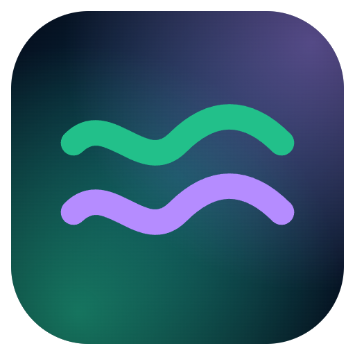
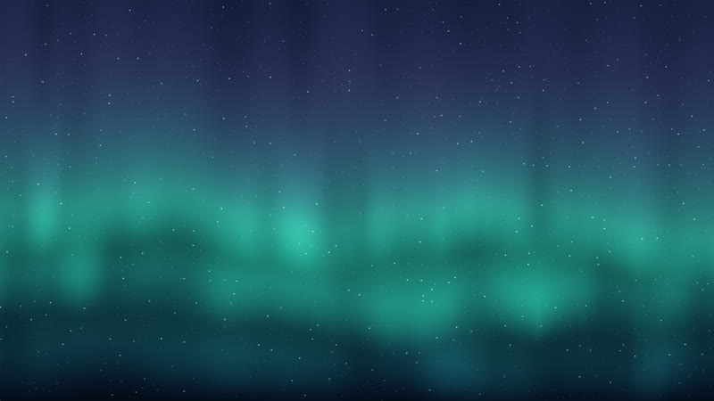
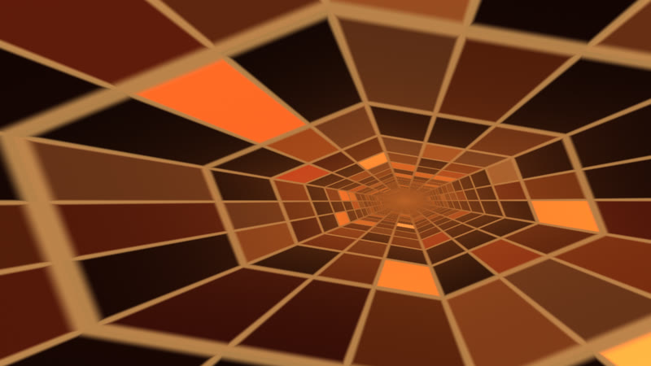
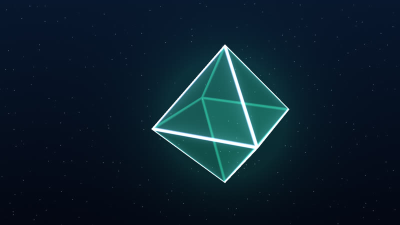
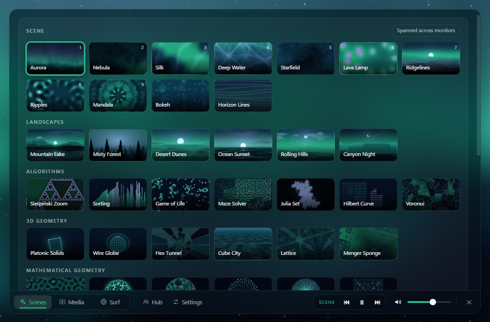
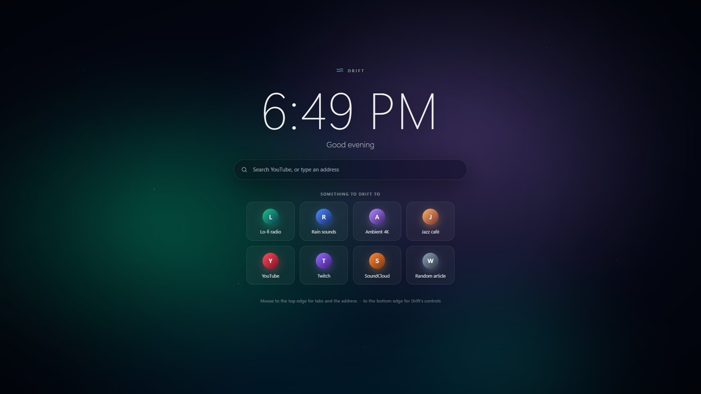

<p align="center">
  
</p>

<h1 align="center">Drift</h1>

<p align="center">
  <b>Turn every monitor you own into one calm, living picture.</b><br>
  40 ambient scenes, your own videos and music, all flowing across your screens in step.
</p>

<p align="center">
  <a href="https://github.com/Rpyaanng/Drift/releases/latest"><b>⬇ Download for Windows</b></a>
  &nbsp;·&nbsp; Free &nbsp;·&nbsp; No account &nbsp;·&nbsp; No ads &nbsp;·&nbsp; MIT licensed
</p>

<p align="center">
  
</p>

---

Your monitors sit dark most of the day. Drift gives them something beautiful to do: a sun setting
over the sea across all three screens, aurora rippling to your music, a hyperbolic tiling slowly
turning while you work, read or wind down. Start it, move the mouse once to pick a scene, and let it
drift.

## Why you'll like it

- **Made for more than one screen.** Drift draws **one scene across all your monitors**, lined up to
  where they really sit, even when they're different sizes. Or show the same scene on each, or give
  every monitor its own.
- **36 scenes and counting.** Northern lights, moonlit lakes, deserts, misty forests, 3D geometry,
  fractals and algorithms you can watch think.
- **It listens.** Scenes breathe with whatever is playing, whether that's the built-in soundscapes,
  your own music or Spotify.
- **Your videos, on every screen.** Play a folder of films or clips across all your monitors, with
  subtitles that find themselves and sound that just works, even Dolby and DTS.
- **Watch together.** Share what you're watching with friends and it plays in step on their PCs too,
  straight from yours, encrypted, with no server in between.
- **Calm by design.** A clock, a breathing guide, a sleep timer that fades everything out, and a
  panel that disappears until you need it.

## Every monitor, your way

<p align="center">
  
</p>

One setting decides how Drift fills your screens:

| | |
| --- | --- |
| **Span** | One picture stretched across every monitor, like a window onto a wider world. |
| **Mirror** | The whole scene on each monitor. |
| **Mix** | A different scene or video on each monitor, as above. |

Need a screen back for work? **Close this monitor** from the exit prompt and Drift keeps running on the
others.

## The scenes

Every scene takes on the colours of the palette you choose (Aurora, Ocean, Sunset, Forest, Ember,
Lavender, Rosé, Moonlight and a near-black Dark for night), or one that slowly cycles through them all,
or colours you pick yourself.

**Ambient**: soft, endless motion to sit behind your day.

| | | | |
| :---: | :---: | :---: | :---: |
| <br>Aurora | <br>Deep Water | <br>Mandala | <br>Nebula |

**Landscapes**: places to rest your eyes.

| | | | |
| :---: | :---: | :---: | :---: |
| <br>Mountain Lake | <br>Ocean Sunset | <br>Misty Forest | <br>Canyon Night |

**Mathematics and algorithms**: hypnotic, with optional captions explaining what you're seeing.

| | | | |
| :---: | :---: | :---: | :---: |
| <br>Hyperbolic Tiling | <br>Apollonian Gasket | <br>Julia Set | <br>Chladni Plate |

**3D geometry**: slow-turning solids, tunnels and cities.

| | | | |
| :---: | :---: | :---: | :---: |
| <br>Wire Globe | <br>Hex Tunnel | <br>Platonic Solids | <br>Menger Sponge |

<details>
<summary><b>See all 36 scenes</b></summary>

- **Ambient**: Aurora, Nebula, Silk, Deep Water, Starfield, Lava Lamp, Ridgelines, Ripples, Mandala,
  Bokeh, Horizon Lines
- **Landscapes**: Mountain Lake, Misty Forest, Desert Dunes, Ocean Sunset, Rolling Hills, Canyon Night
- **Algorithms**: Sierpiński Zoom, Sorting, Game of Life, Maze Solver, Julia Set, Hilbert Curve, Voronoi
- **3D geometry**: Platonic Solids, Wire Globe, Hex Tunnel, Cube City, Lattice, Menger Sponge
- **Mathematical geometry**: Quasicrystal (crossing waves that never repeat), Hyperbolic Tiling ({7,3},
  {5,4}, {8,3} and {4,5} tilings of the Poincaré disc), Apollonian Gasket, Phyllotaxis (golden-angle
  sunflower spirals), Rose Curves (r = cos kθ), Chladni Plate (sand on a vibrating plate)

Change scene automatically every few minutes, in order or shuffled. While it's on, each scene has a
tick in its corner: untick the ones you'd rather skip. Add a spectrum or waveform overlay if you like.

</details>

## Out of the way until you need it

<p align="center">
  
</p>

Move the mouse and a panel slides up on that screen; leave it and it's gone. Everything is a click or a
key away: scenes, colour, speed, brightness, music, video and volume.

## Sound and music

- **Ambient sound**, in the **Scenes** tab: Warm Pads, Deep Space, Crystal Bells and Morning Light,
  generated live rather than played from a loop, or **Off**.
- **Nature sounds**: rain, ocean waves, wind and a crackling fireplace, mixed to taste on top of
  anything (also in Scenes).
- **Your music**: the **Media** tab shows your music next to your videos, in the same folders. Pick a song
  and the scenes dance to it; the ambient sound waits and comes back when you press **Stop music**.
- **Spotify**: there is nothing to set up. While a song plays in the Spotify app on your PC and Drift
  has no video or music of its own on, the toolbar's play, pause, skip and volume control Spotify, with
  the song's name beside them, and the visuals react to it. No login.

## Video, done properly

- **Play your folders** on every screen: spanned, mirrored or on just one monitor. Videos play one
  after another, or switch **Autoplay** off to stop at the end of each.
- **Subtitles that find themselves**: Drift picks your language from tracks inside the video or files
  beside it, or looks them up online by name. Size, colour, style and timing are yours to adjust, and
  remembered for each video.
- **It plays what you throw at it**: Dolby and DTS sound, HDR10, HLG and Dolby Vision, and older
  formats like MPEG-2, Xvid, WMV and AVI are converted live, using your NVIDIA, Intel or AMD graphics
  when it can. An HDR monitor next to an SDR one each get the right picture.
- **Monitors join in step**: switch another screen to the video that's playing and it picks up right
  where the others are.
- **Back where you left it**: Drift opens with the video or song you had on, paused at the same spot and
  ready to carry on when you press play.
- **Smooth next to busy scenes**: if heavy scenes on your other monitors start holding a video back,
  those scenes ease off their frame rate (never their sharpness) until the video plays smoothly again.

## Watch together

Press **Share what I'm watching** and send the invite code. Up to eight friends paste it into their
Drift and see the same video, in step: play, pause and skipping stay together for everyone. The video
streams straight from your PC to theirs, encrypted, with no server, upload or account involved. A
friend who already has the file plays their own copy, and everyone picks their own subtitles.

## Surf, alone or together

<p align="center">
  
</p>

The **Surf** tab puts a web browser on any screen, opening on Drift's own start page: a clock, a search
box and a few places to drift to. Share it from **Together** and your friends see and hear the page with
you. If you let them, they can click, scroll and type in it from their own PC too. Everyone's mouse shows
over the page as a coloured arrow with their name, so you can point things out to each other. Close Drift
with the browser open and your tabs come back next time, without anything starting to play by itself.

<p align="center">
  
</p>

## Get Drift

1. Download **Drift-Windows-x64.zip** from the [latest release](https://github.com/Rpyaanng/Drift/releases/latest)
   (Windows 10/11, 64-bit; ffmpeg included).
2. Unzip it anywhere and double-click `Drift.exe` inside the `Drift-win32-x64` folder.
3. Drift isn't code-signed yet, so Windows may say "Windows protected your PC". Click **More info** →
   **Run anyway**.

Your settings are saved and carry over to new versions.

From 1.5.0 on, Drift **updates itself**. Now and then it checks for a new release, downloads it in the
background and installs it when you close Drift. You can also install it straight away from **Settings →
Updates**, or untick *Update Drift automatically* there. Copies of 1.4.1 and older need this one update by hand.

---

## Controls

Move the mouse and the control panel appears at the bottom of the screen it's on. `Esc` asks before
quitting (`Enter` closes, `Esc` again stays), and from there you can also close just that monitor.

| Key | Action |
| --- | --- |
| `Tab` | Show/hide controls |
| `Space` | Play / pause |
| `Left` / `Right` | Previous / next |
| `Up` / `Down` | Volume |
| `1`–`9` | Pick a scene (Scenes tab) |
| `P` | Colour |
| `C` | Clock |
| `B` | Breathing guide |
| `S` | Subtitles on / off (during a video) |
| `V` | Next subtitle track |
| `Z` / `X` | Subtitles 0.1 s earlier / later |

### Watch together in detail

Play a video, open the **Together** tab and press **Share what I'm watching**. Send the invite code to a
friend; they paste it into the same tab and press **Join**. Up to eight friends can join.

- Play, pause, seeking and moving to the next video stay in step on every PC (untick *Friends can play,
  pause and skip* to keep the controls to yourself). With *Pause for everyone while someone is loading*,
  the video waits for a friend who is still loading, for up to 20 seconds.
- The video is streamed from the sharing PC as it plays, so nothing has to be sent beforehand, and jumping
  around works. A friend who already has the same file (same name and size) in their video folders plays
  their own copy instead.
- *Picture sent between PCs* makes the sharing PC send a smaller converted copy (1080p, 720p or 480p) when
  a connection can't keep up with the original. The sharing PC's upload speed is usually the limit.
- Subtitles on the sharing PC are offered to friends, and each person picks their own track, language and
  style. Sound and HDR conversion happen on each PC for its own screen; a friend without ffmpeg gets the
  sharing PC to convert for them.
- The invite code holds the sharing PC's addresses and a one-time secret. The connection is TLS keyed by
  that secret, so only people with the code can connect or see what is being watched. A new code is made
  every time sharing starts.

Reaching the sharing PC: on the same network it works as is. For friends elsewhere, Drift asks the
router (UPnP) to open one TCP port (47800 by default) while sharing and closes it afterwards; if the
router refuses, the Together tab says so, and forwarding that port by hand works too. In that case, and
when the router doesn't report its own address, Drift looks up this PC's public address at api.ipify.org.
Behind a provider that shares one address between homes (CGNAT), use a VPN such as Tailscale on both PCs.
Windows asks once whether to let Drift through its firewall: allow it.

### Listening to music together

While you are sharing, friends hear your music too: the **ambient sound** and music from your library are
sent to them as one live stream, straight from your PC, so everyone hears the same moment of it (a fraction
of a second after you do). There is nothing to set up: put music on and it reaches whoever has joined.

- A friend's own music waits while they are in your session, and each friend sets their own volume. Their
  visuals move to your music.
- With *Friends can play, pause and skip, and use a web page* ticked, their play, pause, next and previous
  work on your music.
- **Spotify** is not sent: it is Spotify's sound, not Drift's. Nature sounds stay on your own PC too.
- When a video with its sound on takes over from the music on your PC, it does for friends as well.

### Who is where

During a session each tab in the panel carries a small number: how many people (you included) are on it
right now, so you can see who has wandered off to Settings or is looking at the same page as you.

### Surf: a browser in Drift, alone or together

The **Surf** tab is a small web browser. Choose it and the browser opens on that screen, in place of the
scene, on Drift's own start page: a clock, a search box (an address, or something to search YouTube for)
and a few places to drift to. While you are sharing (in **Together**), friends see and hear the tab in
front too: its picture and sound are streamed to them from your PC.

- **The bar at the top.** Move the mouse to the very top edge of the screen and a floating bar drops down
  with your tabs, **+** for a new tab, back, forward, reload, home and the address. It slips away again
  when the mouse leaves it. A link that asks for a new tab opens one; pop-ups are blocked. Up to 12 tabs.
- **Drift's own panel.** The page takes the mouse and keyboard while it is showing. Move the mouse to the
  very bottom edge of the screen for the panel, or press `Esc` in the page (when a video is full screen,
  the first `Esc` leaves that). With Surf selected, the panel's previous / next buttons go back and
  forward, and the video progress bar is hidden.
- **Leaving Surf.** Choosing Scenes or Media on the browser's screen puts the browser away so you can
  see them. Your tabs are kept and their pages load again when you come back to Surf. Together and
  Settings leave the browser where it is. Closing the last tab closes the browser.
- **Next time.** If the browser is open when Drift closes, its tabs, the tab in front and its monitor come
  back when Drift starts again. Video and music in those pages stay paused until you click or press a key
  in the page.
- The browser is on one monitor; the others carry on with their scenes. Choosing Surf on another monitor
  moves it there (the pages load again).
- With *Friends can play, pause and skip, and use a web page* ticked (in Together), friends can click,
  scroll and type in the page from their own PC, and use the same bar for tabs and the address, as you:
  they act in whatever accounts you are signed in to there. Untick it and they only watch. Pasting is
  never passed on, so your clipboard stays yours.
- Everyone sees everyone else's mouse over the page, as a small coloured arrow with their name, so you
  can point at things. A pointer that stops moving fades after a few seconds. A friend's own mouse is
  drawn the same way on their screen, so they see what the others see.
- Only the sharing PC loads the pages, so an account is only needed there. Sign-ins made in Drift are kept
  apart from your normal browser.
- The stream goes straight from PC to PC (WebRTC, encrypted), at 30 frames a second and up to about
  8 Mbit/s of upload for each friend. With *Let friends join from outside my home network* ticked,
  both PCs ask a public STUN server (Google's) what their internet address is so they can find each other;
  nothing of the page passes through it. Some networks can't be connected this way: a VPN such as
  Tailscale on both PCs gets round that.
- Copy-protected video (Widevine) plays, and friends see it too. The first time Surf opens, Chromium downloads
  Widevine from Google (a few MB) and keeps it up to date. Netflix also needs a release that castLabs has
  signed (see Building). Like other Chromium-based browsers apart from Chrome and Edge, Surf gets these
  services' lower quality, usually 720p.
- *Block adverts in Surf* (in Settings, on by default) blocks adverts and trackers in pages, using Ghostery's adblocker library
  with the same filter lists uBlock Origin uses. The lists are downloaded from Ghostery's servers the
  first time and refreshed once a day. Sites fight blockers, so now and then an advert gets through, or a
  page misbehaves: untick it and the pages reload without blocking.
- `Alt+←` / `Alt+→` (or the mouse's side buttons) go back and forward.

### Video conversion

**Settings → Video conversion** needs ffmpeg (included in the release download).

- *HDR videos*: convert to SDR only on screens that aren't showing HDR (the default — an HDR monitor next
  to an SDR one each get the right picture), always, or never.
- *Convert with*: Automatic uses the fastest encoder that actually works on this PC, tried in the order
  NVIDIA, Intel, AMD, then the processor. Every encoder this copy of ffmpeg has and this PC can run is
  listed. H.264 plays everywhere; if an H.265 or AV1 stream won't play, Drift goes back to Automatic.
- *Converted picture size*: Match my screen avoids converting more pixels than the screen has, which is
  what makes 4K HDR practical on an ordinary PC.

A video the built-in player can't open is converted the same way without asking. Converting HDR needs an
ffmpeg built with zscale (libzimg) or libplacebo; the common full builds have both.

### Online subtitle lookup

In the Media tab, **Find online…** fills in the film or show name guessed from the file name. Pressing
Search sends that name to [Cinemeta](https://v3-cinemeta.strem.io) to identify the title, then asks the
public OpenSubtitles mirror used by Stremio for its subtitles. Neither needs an account. Nothing is sent
until Search is pressed, and only the text in the search box goes out. Results whose release name matches
the video file are listed first and marked "Likely match". Downloads are kept in Drift's settings folder,
not beside your videos.

### Privacy

Drift has no account, no telemetry and no ads. Apart from checking for updates (see below), it only goes online when you ask it to: looking up
subtitles, or sharing a video with friends (and then finding your public address if your router doesn't
say). Spotify control talks to the Spotify app on this PC, not the internet. Nothing about you goes with
the update check: it is a plain request for the release list. With *Update Drift
automatically* on (in Settings), Drift asks GitHub about its latest release a little after it starts and
every 12 hours after that, and downloads the release from GitHub when there is a new one.

## Development

Built with [castLabs' Electron](https://github.com/castlabs/electron-releases) (Electron with Widevine) and WebGL shaders.

```sh
npm install
npm start
```

### Building

```sh
npm run dev-build
```

This writes an unpacked (no asar) Windows x64 copy to `dev-build/Drift-win32-x64/`, with a
`BUILD-INFO.txt` recording the commit it was built from. To rebuild automatically after every commit,
turn on the included hook:

```sh
git config core.hooksPath .githooks
```

The app isn't code-signed, so Windows SmartScreen will warn on first launch
("More info" → "Run anyway").

**Netflix needs a VMP signature.** Widevine plays without one, but Netflix (and a few others) only send
video to builds castLabs has signed. Their EVS signing service is free. Set it up once:

```sh
pip install --upgrade castlabs-evs
python -m castlabs_evs.account signup
```

From then on, `dev-build` signs every build, after any other signing as VMP requires. Without EVS it warns
and builds anyway.

### ffmpeg (video sound, HDR, other formats and subtitles inside videos)

Converting Dolby / DTS audio, HDR and other video formats, and reading subtitle tracks stored inside a
video all need `ffmpeg.exe`.
It isn't in this repo (too large for GitHub). Put a copy at `vendor/ffmpeg.exe` (ignored by git), or set
`FFMPEG_EXE` to its path, and `dev-build` copies it into the build's `resources` folder. A build made
without it warns, and the app says so in the Media tab instead of playing in silence.

At runtime Drift looks for ffmpeg in this order:

1. the path in the `DRIFT_FFMPEG` environment variable
2. `resources/ffmpeg.exe` next to the packaged app
3. `ffmpeg.exe` in the project folder, then `vendor/ffmpeg.exe`
4. any `ffmpeg.exe` on the `PATH`

### Developer switches

Environment variables for trying things out: `DRIFT_USERDATA=<folder>` runs a second copy with its own
settings (two copies on one PC can share with each other), `DRIFT_SHARE_LOCAL=1` keeps sharing on this PC,
`DRIFT_FAKE_HDR=0|1` pretends the screens are SDR or HDR, `DRIFT_HIDDEN=1` and `DRIFT_MUTE=1` run without
windows or sound. `DRIFT_SHOTS=<folder>` runs the screenshot tour (add `DRIFT_ONLY=<scene,...>`,
`DRIFT_PALETTE=<name>`, `DRIFT_PANEL=1` and `DRIFT_SHOTWAIT=<ms>` to wait longer per scene); the README images
were made with it. Add `DRIFT_TESTSURF=1` for the picture of Surf's start page. The picture of a page shared in
Surf comes from two copies run at once with `DRIFT_TESTWEB=host` and `=guest` (with the same `DRIFT_TESTCODE`
file, `DRIFT_TESTURL` and `DRIFT_SHARE_LOCAL=1`); `DRIFT_TESTNAME` sets each one's name.
To try updating, run a packaged copy with `DRIFT_FAKE_VERSION=1.0.0` (it then thinks the latest release is
newer) and `DRIFT_UPDATE_AUTOINSTALL=1` (it installs and restarts as soon as the download is ready).

## License

MIT
