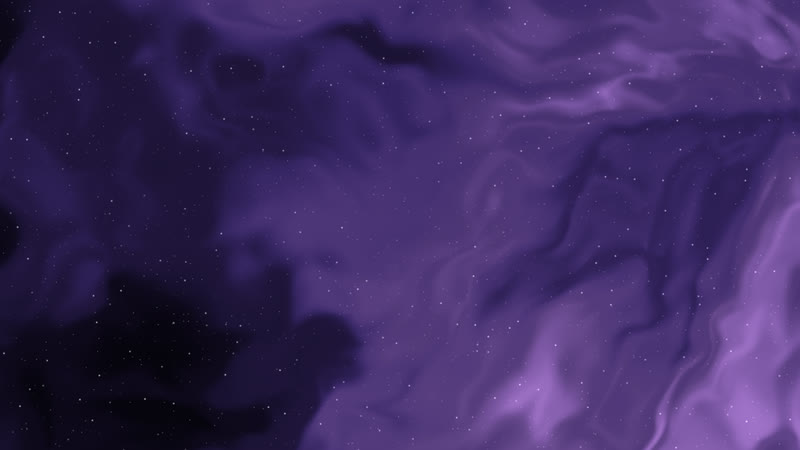
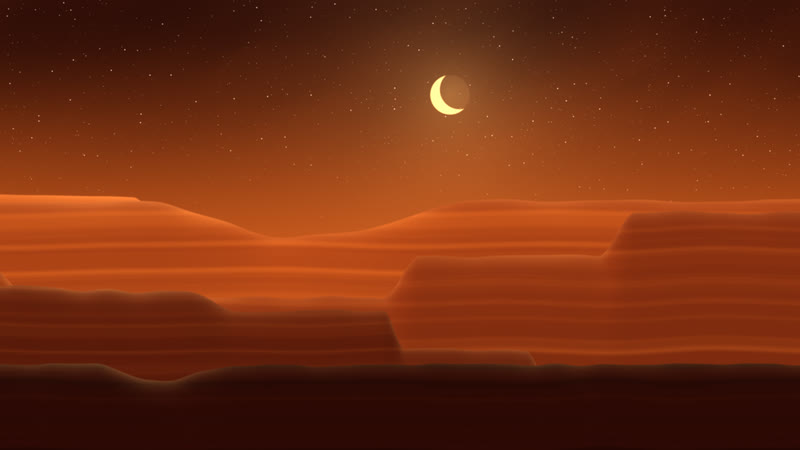
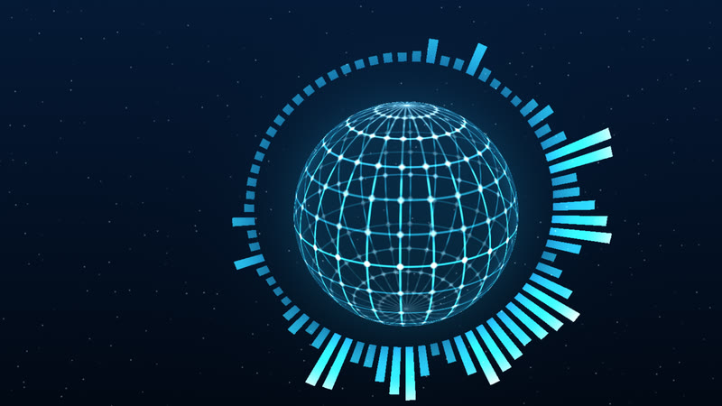
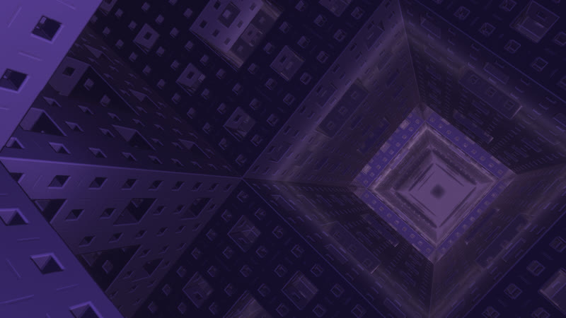
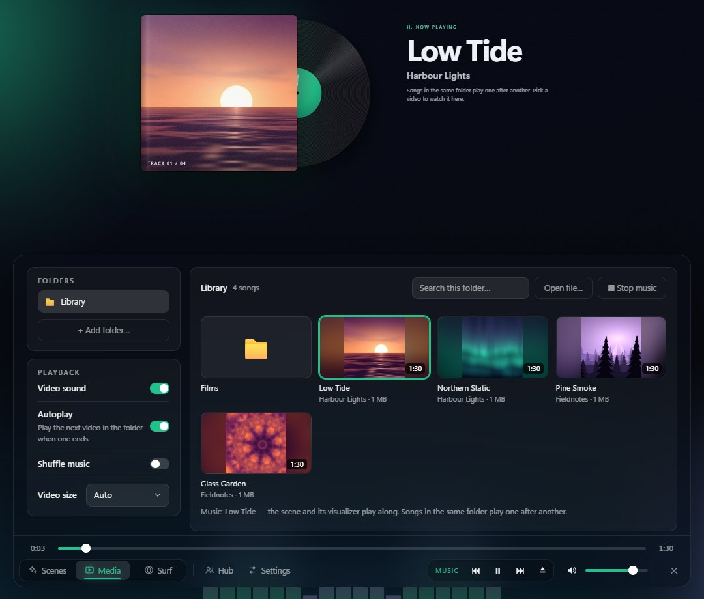
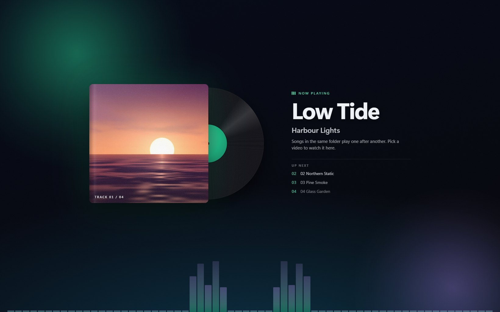
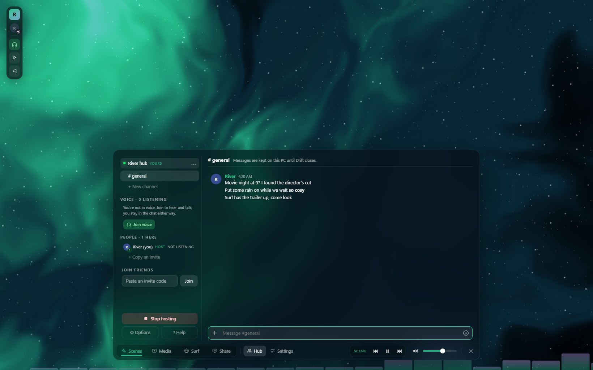

<p align="center">
  
</p>

<h1 align="center">Drift</h1>

<p align="center">
  <b>Turn every monitor you own into one calm, living picture, and share it with your friends.</b><br>
  36 ambient scenes and a blackjack table, your own videos and music, a web browser and a place to hang out with friends, all in one app.
</p>

<p align="center">
  <a href="https://github.com/Rpyaanng/Drift/releases/latest"><b>⬇ Download for Windows</b></a>
  &nbsp;·&nbsp; Free &nbsp;·&nbsp; No account &nbsp;·&nbsp; No ads &nbsp;·&nbsp; MIT licensed
</p>

<p align="center">
  
</p>

---

## Drift in one minute

Drift fills your monitors edge to edge. Move the mouse and a panel slides up at the bottom of that screen. The panel
has two kinds of tabs:

| Tab | What it does |
| --- | --- |
| **Scenes** | Puts an ambient scene on this screen: aurora, landscapes, mathematics, 3D geometry. |
| **Media** | Your videos and music, played on this screen (or across all of them). |
| **Surf** | A web browser on this screen. |
| **Share** | Shows your screen or an app to your hub, and shows you what friends are sharing. |
| **Hub** | Your friends: chat, voice, and watching together. Opens over what's on screen and leaves it there. |
| **Settings** | Monitors, quality, video conversion, updates. Also opens over what's on screen. |

The first four tabs decide **what this screen shows**. The underline shows which one is on. Hub and Settings are
panels you open on top of it. Leave the panel alone and it hides again.

<p align="center">
  
</p>

## Get Drift

1. Download **Drift-Windows-x64.zip** from the [latest release](https://github.com/Rpyaanng/Drift/releases/latest)
   (Windows 10/11, 64-bit; ffmpeg included).
2. Unzip it anywhere and double-click `Drift.exe` inside the `Drift-win32-x64` folder.
3. Drift isn't code-signed yet, so Windows may say "Windows protected your PC". Click **More info** → **Run anyway**.

Your settings carry over to new versions. Drift **updates itself**: when a new release is out, a download icon appears
on the **Settings** tab. Press **Download update**, then restart now or let it install when you close Drift. Tick
*Update Drift automatically* to have this happen in the background. The first time a new version opens, **What's new**
shows what changed; **Settings → Updates → What's new** has every version's notes.

---

## Every monitor, your way

<p align="center">
  
</p>

One setting (**Settings → Monitors → Across monitors**) decides how Drift fills your screens:

| Layout | What you get |
| --- | --- |
| **Span** | One picture across every monitor, lined up to where they really sit, even when they're different sizes. |
| **Mirror** | The whole picture on each monitor. |
| **Mix** | Each monitor shows its own thing: a different scene, a video, a web page (as above). |

Need a screen back for work? Turn that monitor off under **Settings → Monitors**, or press `Esc` and choose **Close this
monitor**. Drift keeps running on the others.

## Scenes

Every scene takes the colours of the palette you pick: Aurora, Ocean, Sunset, Forest, Ember, Lavender, Rosé, Moonlight, a
near-black Dark for night, one that slowly cycles through them all, or your own. Scenes move with whatever is playing:
Drift's ambient sound, your music, or Spotify.

**Ambient**: soft, endless motion to sit behind your day.

| | | | |
| :---: | :---: | :---: | :---: |
| <br>Aurora | <br>Deep Water | <br>Mandala | <br>Nebula |

**Landscapes**: places to rest your eyes.

| | | | |
| :---: | :---: | :---: | :---: |
| <br>Mountain Lake | <br>Ocean Sunset | <br>Misty Forest | <br>Canyon Night |

**Mathematics and algorithms**: hypnotic, with optional captions explaining what you're seeing.

| | | | |
| :---: | :---: | :---: | :---: |
| <br>Hyperbolic Tiling | <br>Apollonian Gasket | <br>Julia Set | <br>Chladni Plate |

**3D geometry**: slow-turning solids, tunnels and cities.

| | | | |
| :---: | :---: | :---: | :---: |
| <br>Wire Globe | <br>Hex Tunnel | <br>Platonic Solids | <br>Menger Sponge |

<details>
<summary><b>All 37 scenes</b></summary>

- **Ambient**: Aurora, Nebula, Silk, Deep Water, Starfield, Lava Lamp, Ridgelines, Ripples, Mandala, Bokeh, Horizon Lines
- **Landscapes**: Mountain Lake, Misty Forest, Desert Dunes, Ocean Sunset, Rolling Hills, Canyon Night
- **Algorithms**: Sierpiński Zoom, Sorting, Game of Life, Maze Solver, Julia Set, Hilbert Curve, Voronoi
- **3D geometry**: Platonic Solids, Wire Globe, Hex Tunnel, Cube City, Lattice, Menger Sponge
- **Mathematical geometry**: Quasicrystal (crossing waves that never repeat), Hyperbolic Tiling ({7,3}, {5,4}, {8,3} and
  {4,5} tilings of the Poincaré disc), Apollonian Gasket, Phyllotaxis (golden-angle sunflower spirals), Rose Curves
  (r = cos kθ), Chladni Plate (sand on a vibrating plate)
- **Games room**: Blackjack (below)

</details>

Drift can change scene by itself every few minutes, in order or shuffled. While that's on, untick a scene's corner to
skip it. The Games room is never picked. You can also add a spectrum, waveform or halo overlay, a clock, or a breathing guide.

### Blackjack

**Scenes → Games room → Blackjack** is a casino blackjack table in a dark room, lit by a lamp in your palette's colours.
Everyone plays the dealer: hit, stand, double, split, insurance and surrender; the dealer stands on all 17s and
blackjack pays 3 to 2. Bets are 10 to 500. Run out of chips and you're back in with 1,000 after 20 seconds.

- **Alone**, the table is yours and your chips are kept.
- **Online in a hub**, you sit at the hub's table with everyone there, up to six at once (the rest wait for a seat), each
  starting with 1,000. You see each other's cards, pointers and pictures, and the hub keeps a board of its five
  **biggest pots**. Click someone at the table in the hub bar to sit down next to them. **Stand up** to watch.
- The table has its own sounds, with their own switch in the Hub tab's Sounds.

## Sound

- **Ambient sound** (Scenes tab): Warm Pads, Deep Space, Crystal Bells or Morning Light. Drift generates it live, so it
  never loops.
- **Nature sounds**: rain, ocean waves, wind and a crackling fireplace, mixed to taste on top of anything.
- **Your music** plays from the **Media** tab (below). The ambient sound pauses while it plays.
- **Spotify**: nothing to set up and no login. While Spotify plays on your PC and Drift isn't playing anything of its
  own, the toolbar's play, pause, skip and volume control Spotify, and the scenes move to it.
- **Volume mixer**: click the speaker in the toolbar for one slider per sound, like Windows' mixer: Drift as a whole,
  Ambient, Media, Surf's web pages, and Spotify. Click a row's icon to mute it.

## Media: your videos and music

Pick **Media** and the screen becomes a player. Add your folders once. Videos and songs share the same folders, and
each song shows its own cover, title and artist, read from its tags (or a `cover.jpg` beside it).

<p align="center">
  
</p>

**Music** gets a screen of its own: the cover on a record that turns with the beat, what's playing and what's next,
and a spectrum that moves to the song. The record and the cover tilt toward the mouse.

<p align="center">
  
</p>

**Videos** play on one screen, mirrored, or across all of them:

- **Plays almost anything.** Dolby and DTS sound, HDR10, HLG and Dolby Vision, and older formats like MPEG-2, Xvid, WMV
  and AVI are converted live, on your NVIDIA, Intel or AMD graphics when possible. An HDR monitor next to an SDR one
  each get the right picture.
- **Subtitles find themselves**: from tracks inside the video, files beside it, or an online lookup by name. Size,
  colour, style and timing are yours, remembered for each video.
- **Paused, it tells you what it is**: the title and where you stopped, over the frame.
- **Picks up where you left off.** Drift reopens with the video or song you had on, paused at the same spot.
- **Monitors stay in step.** Switch another screen to the video that's playing and it joins at the same moment.
- **Smooth next to busy scenes.** If heavy scenes on other monitors start holding a video back, they lower their frame
  rate (never their sharpness) until it plays smoothly.

Press **Eject** (⏏ in the toolbar) to put your video or music away.

<p align="center">
  
</p>

## Surf: a web browser on any screen

<p align="center">
  
</p>

**Surf** puts a browser on the screen, opening on Drift's own start page: a clock, a search box, shortcuts, and widgets
for markets, headlines, the weather and more (**Customize** picks which). Move the mouse to the **top edge** for the tab
bar (tabs, back, forward, reload, address). Move it to the **bottom edge**, or press `Esc`, for Drift's panel.

- Up to 12 tabs, with the usual shortcuts (`Ctrl+T`, `Ctrl+W`, `Ctrl+Shift+T`, `Ctrl+Tab`, `Ctrl+L`, `F5`, zoom…).
- **Adverts blocked** with uBlock Origin, the real extension, running inside Surf (on by default; Settings).
- **Netflix, Disney+ and other protected video** play (Widevine), at the 720p these services give Chromium browsers.
- **Show it on every monitor**: the two-screens button in the tab bar, or **Mirror** in Settings, mirrors the page to
  your other monitors. You can click and type in it from any of them.
- Choosing Scenes or Media puts the browser away **without closing it**: come back and your tabs are exactly as you left
  them, still playing. Close Drift with Surf open and your tabs come back next time, paused.
- Sign-ins made in Surf are kept apart from your normal browser.

## The Hub: your friends, in Drift

<p align="center">
  
</p>

A **hub** is a small private place for you and your friends, hosted by one of your own Drifts. There's no server,
company or account in between. In a hub you can:

- **Chat** in channels, with replies, editing, reactions, emoji, pictures and GIFs, and a little formatting
  (`**bold**`, `*italic*`, `` `code` ``, `||spoiler||`, `> quote`). Press **Enter** anywhere in Drift to write a
  message without opening the Hub tab.
- **Send files** of any size. Press **+**, paste or drop a file on the chat and press **Enter**. Pictures and GIFs up
  to 4 MB are kept on the hub as before; anything else stays on your PC, and friends download it straight from yours.
  Downloads can be paused and resumed (even after a restart), and every piece is checked as it arrives.
- **Talk** in the hub's voice room. Press **Join voice** to hear everyone, then unmute to talk. Push-to-talk works even
  while a game has the keyboard.
- **Watch and listen together.** Pick a video or a song while you're in a hub and Drift asks whether to play it just
  for you or share it with the hub. Shared, it plays on everyone's PC in step, streamed straight from yours.
- **Browse together.** Online in a hub, the Surf tab becomes the hub's **Surf stream**: one browser everyone shares.
  Anyone can click, scroll and type, and everyone sees each other's pointers.
- **Share a screen.** The **Share** tab shows a monitor or a single app to the hub, with or without sound. Friends'
  broadcasts appear there as a grid. Click one to watch it full screen.

**Getting started:** open the **Hub** tab, press **Host**, then **Copy an invite** and send the code to your
friends. They paste it into their own Hub tab and press **Join**. An invite works for 7 days. Click a hub to go online in
it. Drift never connects to a hub by itself.

**The hub bar.** While you're in voice or watching together, a slim rail sits on the left edge of every screen. It
shows the hub, everyone online with their mic state and what they're sharing, and buttons for **Mute**, **Leave voice**
and **Hide cursor**. Click someone's face to jump to what they're looking at. When nobody touches it, it fades into the
scene. It stays bright while your microphone is open.

**Pointing at things.** Over a paused shared video, a broadcast you're watching full screen, or the Surf stream, everyone
sees each other's pointer in their own colour with their name. **Hide cursor** in the hub bar keeps yours to yourself.

### Voice

- **Microphone, speakers and noise suppression** are chosen in the Hub's **Options**. **Strong** suppression
  (RNNoise, running on your PC) removes keyboards, fans and traffic and adds about 10 ms of delay. **Test** shows what
  others would hear, without sending anything.
- Up to 16 people in a room, 8 talking at once. Each person has their own volume slider, just for you.
- Your microphone starts closed every time Drift starts, unless you tick *Keep my microphone on between sessions*.
- The tray icon is grey while your mic is closed and red while it's open. Click it to mute or unmute.

### Private by design

- **End-to-end encrypted voice and video.** Sound and pictures go from your PC to your friends' encrypted (DTLS-SRTP).
  The hub only relays the messages that set up each connection, and Drift signs every one of them. A 🔒 marks each
  connection Drift has verified. If a check fails, Drift refuses to connect and tells you why.
- **Your address stays private.** Voice and streams go through the hub's PC by default, so nobody learns anyone else's IP
  address. *Connect directly* trades that for a little less delay.
- **Safety numbers.** Click someone under *People* to compare a 12-digit number with them in person or on the phone. If
  it matches, nobody (not even the hub) is pretending to be either of you.
- **No accounts.** Each person is a key made by their own Drift, kept encrypted by Windows. Messages live on the host's
  PC, and the hub only works while the host's Drift is open. The host can remove people and delete messages; anyone can
  **Block** someone, which hides them for you.
- Pictures you send and your profile picture are saved again small before sending, which removes hidden details such as
  where a photo was taken.
- **Files go straight between your PCs, encrypted.** The hub never sees them or keeps them. Files up to 500 MB go
  through the hub's relay, so nobody learns anyone's address; the relay sends files at up to 2 MB/s, so a download never
  crowds out voice. Bigger files connect directly, and Drift asks first because each of you then sees the other's IP
  address. Drift checks every piece against the check that came with the offer, so a file that was changed or damaged on
  the way is never kept. Before you open a received program or shortcut, Drift asks whether you trust it.

---

## Controls

Move the mouse to show the panel on that screen. `Esc` asks before quitting (`Enter` closes, `Esc` again stays) and
offers to close just that monitor.

| Key | Action |
| --- | --- |
| `Tab` | Show / hide the panel |
| `Space` | Play / pause |
| `Left` / `Right` | Previous / next |
| `Up` / `Down` | Volume |
| `1`–`9` | Pick a scene (Scenes tab) |
| `P` | Next colour palette |
| `C` | Clock |
| `B` | Breathing guide |
| `Enter` | Write in the hub chat (while online in a hub) |
| `S` | Subtitles on / off (during a video) |
| `V` | Next subtitle track |
| `Z` / `X` | Subtitles 0.1 s earlier / later |

Surf's own shortcuts are listed under [Surf in detail](#surf-in-detail).

## Privacy

Drift has no account, no telemetry and no ads. It goes online only when you ask it to (looking up subtitles, using a hub,
browsing in Surf) and to check GitHub for updates. That check is a plain request for the release list, sent a little after
Drift starts and every 12 hours after that, and carries nothing about you. Spotify control talks to the Spotify app on
your PC, not the internet.

---

## In detail

<details>
<summary><b>Watching together</b></summary>

- Up to eight people watch at once. Play, pause, seeking and moving to the next video stay in step on every PC. Untick
  *Friends can play, pause and skip* to keep the controls to yourself. With *Pause for everyone while someone is
  loading*, the video waits up to 20 seconds for a friend who's still loading.
- If something is already playing in the hub, a card asks everyone whether to switch to yours. If more than half of the
  people online agree within 30 seconds, it switches.
- The video streams from the sharing PC as it plays, so nothing is sent ahead of time and jumping around works. A friend
  who already has the same file (same name and size) in their own library plays their own copy.
- *Picture sent between PCs* makes the sharing PC send a smaller copy (1080p, 720p or 480p) when a connection can't keep
  up. The sharing PC's upload speed is usually the limit.
- Everyone picks their own subtitles. Sound and HDR are converted on each PC for its own screen. A friend without ffmpeg
  has the sharing PC convert for them.
- **Music** you share reaches everyone as one live stream, a fraction of a second behind you. Each friend sets their own
  volume, and their scenes move to your music. Spotify and nature sounds stay on your PC.
- Messages from the hub float over the video in a corner and fade after a few seconds. In *Options → Chat over the
  video* you choose whose: everyone's, only people you can't hear, or nobody's.
- Each share has its own one-time code, passed around inside the hub. The connection is TLS keyed by that code, so only
  hub members can connect. A new code is made every time sharing starts.

</details>

<details>
<summary><b>The Surf stream (one browser for the whole hub)</b></summary>

- It runs on the host's PC in a separate profile, signed out of everything, with none of the host's own cookies,
  history or sign-ins. It runs alongside the media stream, so one person's video can play while someone else scrolls a
  page.
- Nobody owns it and there's no vote: anyone online can open pages, click, scroll, type and open or close tabs.
- Everyone else gets a live picture of it with sound: 1080p at 30 frames a second, up to about 8 Mbit/s of the host's
  upload per viewer, for up to seven viewers. It's relayed through the hub unless *Connect directly* is on, and it's
  end-to-end encrypted, like voice. Its sound keeps playing at the mixer's Surf level while you're on another tab.
- **What can't happen**, because it would happen on the host's PC: pop-up windows (they open as tabs), file pickers,
  page dialogs, camera, microphone or location permissions, and reaching the host's own network. The host can allow
  particular local addresses in Settings.
- **Downloads wait for the host.** A card on the host's screens asks **Save** or **Refuse**. Saved files go to the
  host's Downloads folder and never leave the host's PC.
- Anything signed into on the Surf stream is signed in for everyone in the hub. Drift says so the first time someone
  types into a password box. Sites see the host's internet address.
- Its tabs are kept while the hub runs and across restarts, until the host presses **Settings → Your hub's Surf stream →
  Clear**.

</details>

<details>
<summary><b>Sharing a screen (the Share tab)</b></summary>

- Pick a whole monitor or a single application, then **Go live**. Quality can be *Auto*, *Text and detail* or *Smooth*,
  and sound can be on or off.
- While you're live: **Switch source** shows something else without anyone dropping, and **Pause** and **Stop sharing**
  do what they say. A list shows who's watching.
- Friends who share their cursor can point at things on your screen. It's only a picture: they can't click or type.
  Turn *Viewers' pointers* off to hide them. Over a game, use borderless or windowed mode to see them.
- Broadcasts are end-to-end encrypted and signed, like voice.

</details>

<details>
<summary><b>Reaching friends over the internet</b></summary>

On the same network it just works. For friends elsewhere, Drift asks your router (UPnP) to open its ports while you host
or share, and closes them afterwards. The hub uses port 47900 (TCP for chat, UDP for voice), and sharing a video uses
TCP 47800. If the router refuses, the Hub tab says so, and its **Help** page explains how to forward the ports by hand.
If your router doesn't report its public address, Drift looks it up at api.ipify.org.

Drift tries this once when you go online in a hub (and again every half hour), before you share anything. If friends online on
other networks couldn't reach your PC, **Share to hub** is greyed out and says why; if Drift couldn't tell, it warns you.

If your internet provider shares one address between homes (CGNAT), no router setting can help. Ask the provider for a
public IP address, let a friend whose connection works host the hub, or use a VPN such as Tailscale on both PCs. Windows
asks once whether to let Drift through its firewall: allow it.

</details>

<details>
<summary><b id="surf-in-detail">Surf in detail</b></summary>

- **Shortcuts**: `Ctrl+T` new tab, `Ctrl+W` close tab, `Ctrl+Shift+T` reopen the last closed tab, `Ctrl+Tab` /
  `Ctrl+Shift+Tab` (or `Ctrl+PgDn` / `Ctrl+PgUp`) next and previous tab, `Ctrl+1`…`Ctrl+8` a tab, `Ctrl+9` the last tab,
  `Ctrl+L` / `Alt+D` / `F6` the address bar, `Ctrl+R` / `F5` reload (`Ctrl+Shift+R` / `Ctrl+F5` ignores the cache),
  `Alt+Left` / `Alt+Right` back and forward, `Alt+Home` the start page, `Ctrl` with `+`, `-`, `0` or the mouse wheel to
  zoom. They work on a hub's Surf stream too.
- A small window a page opens when you click (sign in with Google, PayPal…) opens over Drift. Pop-ups that open by
  themselves are blocked.
- With Surf selected, the panel's previous / next buttons go back and forward.
- The browser lives on one monitor. Choosing Surf on another monitor moves it there.
- While mirrored, the page keeps the layout of the monitor you browse on, stretched slightly toward the shape of your
  other monitors so the black bars are shared out. **Settings → Draw Surf on the graphics card** (experimental) sends the
  mirrored page straight from the graphics card instead of as a video stream, for a sharper picture at full frame rate.
- **Adverts**: the first time, Drift downloads one exact release of [uBlock Origin](https://github.com/gorhill/uBlock)
  (GPLv3) from its GitHub page (about 6 MB, checked against a known fingerprint) into its settings folder. uBlock Origin
  then keeps its filter lists up to date by itself. If a page misbehaves, untick *Block adverts in Surf* and the pages
  reload without blocking.
- **Protected video**: the first time Surf opens, Chromium downloads Widevine from Google (a few MB) and keeps it up to
  date. Netflix also needs a release castLabs has signed (see [Building](#building)).

</details>

<details>
<summary><b>Video conversion</b></summary>

**Settings → Video conversion** needs ffmpeg (included in the release download).

- *HDR videos*: convert to SDR only on screens that aren't showing HDR (the default), always, or never.
- *Convert with*: Automatic uses the fastest encoder that actually works on this PC, trying NVIDIA, Intel, AMD, then the
  processor. Every encoder this ffmpeg has and this PC can run is listed.
- *Converted picture size*: *Match my screen* avoids converting more pixels than the screen has, which is what makes 4K
  HDR practical on an ordinary PC.

A video the built-in player can't open is converted the same way automatically. Converting HDR needs an ffmpeg built
with zscale (libzimg) or libplacebo. The common full builds have both.

</details>

<details>
<summary><b>Online subtitle lookup</b></summary>

In the Media tab, **Find online…** fills in the film or show name guessed from the file name. Pressing **Search** sends
that name to [Cinemeta](https://v3-cinemeta.strem.io) to identify the title, then asks the public OpenSubtitles mirror
used by Stremio for subtitles. Neither needs an account. Nothing is sent until you press Search, and only the text in
the search box goes out. Results whose release name matches the video file are listed first as "Likely match".
Downloads are kept in Drift's settings folder, not beside your videos.

</details>

---

## Development

Built with [castLabs' Electron](https://github.com/castlabs/electron-releases) (Electron with Widevine) and WebGL shaders.

```sh
npm install
npm start
```

### Building

```sh
npm run dev-build
```

This writes an unpacked Windows x64 copy to `dev-build/Drift-win32-x64/`, with a `BUILD-INFO.txt` recording the commit it
was built from. To rebuild automatically after every commit, turn on the included hook:

```sh
git config core.hooksPath .githooks
```

**Netflix needs a VMP signature.** Widevine plays without one, but Netflix (and a few others) only send video to builds
castLabs has signed. Their EVS signing service is free. Set it up once:

```sh
pip install --upgrade castlabs-evs
python -m castlabs_evs.account signup
```

From then on, `dev-build` signs every build, after any other signing as VMP requires. Without EVS it warns and builds
anyway.

### Release notes and releasing

The first time a new version starts, Drift opens **What's new** on the main monitor. It shows that version's notes, with
every version since the last one seen marked New. **Settings → Updates → What's new** opens it again, with every past
version. The notes are written once, in the repo, and the GitHub release's description is made from the same file.

Each version has `renderer/whats-new/<version>.md`, with any pictures in `renderer/whats-new/<version>/`:

```md
---
version: 1.9.1
date: 2026-11-25
title: Send files of any size, straight from your PC      # up to 80 characters
hero: hero.svg                                             # optional, across the top
hero-alt: Two PCs passing a file between them              # required with a hero
---

## New                                                     # or Fixed, Improved, Changed

- **A bold start.** Becomes the item's title; the rest is its text.
  - An indented item belongs to the one above.

                     # a picture on its own line

> A note.
```

Pictures are png, jpg, webp, gif (each under 1.5 MB) or svg (under 250 KB, with no scripts or outside links).
`node scripts/check-notes.js` checks all of it. CI runs it on every push and pull request (`.github/workflows/notes.yml`),
and the pre-push hook runs it too, so **a version can't be pushed without its notes**. It also checks that every tag has
notes and that no stray pictures are left behind.

To release:

1. Bump `version` in `package.json` and write `renderer/whats-new/<version>.md`.
2. `node scripts/check-notes.js`, then build and zip `Drift-win32-x64` as `Drift-Windows-x64.zip`.
3. `node scripts/release-notes.js --zip Drift-Windows-x64.zip > notes.md` writes the release's description: the notes,
   with their pictures pointing at the tag's copy, then the download section and the zip's SHA-256 (the updater checks every
   download against it).
4. Commit, tag `v<version>`, push both, then
   `gh release create v<version> Drift-Windows-x64.zip --title "Drift <version>" --notes-file notes.md`.

### ffmpeg

Converting Dolby / DTS audio, HDR and other video formats, and reading subtitle tracks inside a video all need
`ffmpeg.exe`. It isn't in this repo (too large for GitHub). Put a copy at `vendor/ffmpeg.exe` (ignored by git), or set
`FFMPEG_EXE` to its path, and `dev-build` copies it into the build's `resources` folder. A build made without it warns,
and the app says so in the Media tab instead of playing in silence.

At runtime Drift looks for ffmpeg in this order:

1. the path in the `DRIFT_FFMPEG` environment variable
2. `resources/ffmpeg.exe` next to the packaged app
3. `ffmpeg.exe` in the project folder, then `vendor/ffmpeg.exe`
4. any `ffmpeg.exe` on the `PATH`

### Tests and developer switches

Environment variables for trying things out:

- `DRIFT_USERDATA=<folder>` runs a second copy with its own settings (two copies on one PC can share with each other).
- `DRIFT_SHARE_LOCAL=1` keeps sharing on this PC. `DRIFT_FAKE_HDR=0|1` pretends the screens are SDR or HDR.
- `DRIFT_HIDDEN=1` and `DRIFT_MUTE=1` run without windows or sound. `DRIFT_FAKE_DISPLAYS=N` splits one screen into N fake
  monitors (`DRIFT_FAKE_WIDTHS=1,2` makes them different widths).
- `DRIFT_SHOTS=<folder>` runs the screenshot tour (add `DRIFT_ONLY=<scene,...>`, `DRIFT_PALETTE=<name>`,
  `DRIFT_PANEL=1` and `DRIFT_SHOTWAIT=<ms>`). The scene pictures in this README were made with it.
  `node scripts/readme-shots.js [folder]` makes the rest (Span, Mix, the panel, Media, Surf and the Hub) on this PC's
  own monitors, with a made-up library and its own settings folder.
- `DRIFT_FAKE_VERSION=1.0.0` (in a packaged copy) makes Drift think the latest release is newer;
  `DRIFT_UPDATE_AUTOINSTALL=1` installs and restarts as soon as the download is ready.

Tests (each starts its own copies of Drift, with their own settings):

| Command | Checks |
| --- | --- |
| `node scripts/test-chat.js`, `node scripts/test-voice.js` | Chat and voice logic (no Electron needed) |
| `node scripts/test-reach.js` | The check of whether friends elsewhere could watch, before anything is shared (no Electron needed; `DRIFT_REACH=internet\|lan\|manual` decides what it finds) |
| `node scripts/test-files.js` | Files sent between PCs: pieces and their check, resuming, the signed setup, the limits (no Electron needed; `DRIFT_BIG=1` adds a 5 GB file) |
| `node scripts/test-file-transfer.js` | Two copies: a file through the relay, paused and resumed, and a 600 MB one directly |
| `node scripts/check-notes.js`, `node scripts/test-notes.js` | Every version's release notes, and the notes reader, checker and release description (no Electron needed; CI runs both) |
| `node scripts/test-whats-new.js` | What's new: opens by itself after an update with what changed since, pictures, keys, Settings, and only once |
| `node scripts/test-calls.js` | Three copies in a voice room, honestly and with the hub tampering (`DRIFT_HUB_TAMPER=fingerprint\|unsigned\|replay\|swapkey`) |
| `node scripts/test-mic.js` | The microphone test and noise suppression |
| `node scripts/test-covers.js` | Song covers, titles and artists from tags |
| `node scripts/test-surf-stream.js` | Two copies through a hub's Surf stream |
| `node scripts/test-blackjack-engine.js` | Blackjack's rules, with stacked cards and a fake clock (no Electron needed; seconds) |
| `node scripts/test-blackjack.js` | Two copies at the Blackjack table: alone, then side by side at a hub's (about a minute; `timeout 240`) |
| `node scripts/test-surf-lan.js` | The Surf stream's guard against the host's network (no Electron needed) |
| `node scripts/test-broadcast-ui.js` | The Share tab's real buttons, with two copies |
| `node scripts/test-broadcast.js [modes...]` | Three copies through a whole broadcast: the grid, full screen, pointers, Switch source, Pause, Stop, sound, and hub tampering |

In-app checks are switched on with `DRIFT_TEST*` variables alongside `DRIFT_SHOTS`: `DRIFT_TESTSURF` (Surf's start page),
`DRIFT_TESTMIRROR` with `DRIFT_FAKE_DISPLAYS=2` (Surf's mirroring; add `DRIFT_TESTGPU=1` for graphics-card drawing),
`DRIFT_TESTKEYS` (Surf's shortcuts), `DRIFT_TESTMIX` (the volume mixer) and `DRIFT_TESTPARK` (a Surf page put away and
shown again isn't reloaded).

## License

MIT
